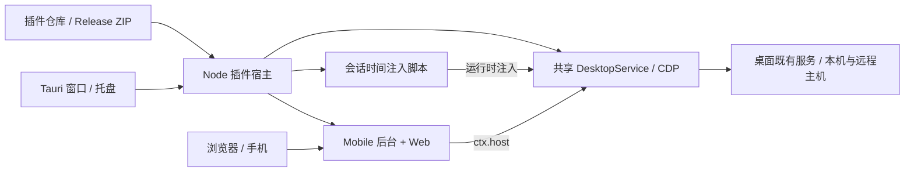

# Codex Launcher

[](LICENSE)

[安卓构建与下载](https://github.com/loock-ai/codex-launcher-plugins/blob/main/plugins/mobile/app/README.md) · [桌面安装包](https://github.com/loock-ai/codex-launcher/releases) · [插件仓库](https://github.com/loock-ai/codex-launcher-plugins) · [使用指南](docs/desktop-launcher.md) · [架构](docs/launcher-architecture.md) · [插件开发](docs/launcher-plugin-sdk.md)

**管理桌面插件，在浏览器和手机上继续 Codex 会话。**

Codex Launcher 是基于 **Tauri 2** 的桌面插件宿主，负责窗口、插件生命周期、配置和共享桌面连接。插件可以提供 Node 后台、配置页面和桌面注入脚本，并从独立仓库安装、更新。

默认提供两个插件：

| 插件 | 功能 |
| --- | --- |
| **Mobile** | 手机 Web、项目与会话、消息与附件、审批、运行中引导及 Dots |
| **会话时间** | 在桌面侧边栏显示会话最近活动时间 |

插件源码由 [codex-launcher-plugins](https://github.com/loock-ai/codex-launcher-plugins) 独立维护。Mobile 的 Web、业务后台和运行依赖随插件包发布，常规升级不要求重新安装 Launcher。安卓客户端仍叫 **Codex Mobile**，其封装、构建与发布也由插件仓库负责，并与 Mobile Web 共用 `plugins/mobile/source/src/` 的 UI。原 npm CLI 仍叫 `codex-mobile`。

> 本项目独立开发，与 OpenAI 官方没有隶属关系。

## 快速开始

### 1. 安装

从 [Releases](https://github.com/loock-ai/codex-launcher/releases) 选择 `desktop-v` 桌面版本：

| 电脑 | 安装包 |
| --- | --- |
| macOS 13.5+，M 系列芯片 | `CodexLauncher-版本-darwin-aarch64.dmg` |
| macOS 13.5+，Intel | `CodexLauncher-版本-darwin-x86_64.dmg` |
| Windows 10+，x64 | `CodexLauncher-版本-windows-x86_64.exe` |

安装 [Node.js 20+](https://nodejs.org/zh-cn/download)，准备已安装、已登录的 ChatGPT/Codex 桌面端。Launcher 使用电脑上的 Node，不内置 Node 运行时；使用安装包不需要 Rust。Windows 需要 WebView2。

macOS 打开 DMG，将 **Codex Launcher.app** 拖到“应用程序”；Windows 运行 EXE 安装器。当前包未配置 Apple 公证或 Windows 代码签名，首次打开可能需要按系统提示允许运行。`SHA256SUMS.txt` 提供安装包校验值。

### 2. 配置桌面并打开 Web

1. 打开 Launcher，或单击状态栏／托盘图标。
2. 在 **桌面** 页核对桌面应用路径和 CDP 端口，默认端口为 `9333`。
3. 在 **插件** 页打开 **Mobile → 配置**，选择 **CDP 桌面桥接**，点击 **打开 Web**。该动作会按需启动 Mobile 服务。
4. 手机与电脑连接同一网络，展开二维码扫码，或复制完整连接链接到手机浏览器。

若桌面已运行但没有开启 CDP，可点击 **强制重启 ChatGPT**。它直接关闭并重启所配置桌面应用，不弹确认框，先处理好运行中的任务。完整连接链接含访问口令，请勿公开分享。

| 默认连接 | 值 |
| --- | --- |
| Mobile Web 网关 | `19877` |
| 本机 CDP | `9333`，仅本机监听 |
| macOS 桌面路径 | `/Applications/ChatGPT.app` |

Mobile 另保留托管、外部 app-server 两种模式；这两种模式不保证与桌面实时会话同步，见 [使用指南](docs/desktop-launcher.md)。

## 插件操作

标题和导航固定在顶部，页面内容可滚动，滚动条隐藏。

- **启动／停止**是同一个按钮：启动时自动加载插件，停止保留配置，不关闭 ChatGPT。打开配置页可以只加载后台，不启动服务。
- **随启动器启动**控制下次打开 Launcher 时是否运行；它不是系统开机启动设置。
- **检查插件更新**只读取版本目录；选择某个插件的安装或更新按钮后，才下载、校验并安装。
- **重新加载插件**读取本地代码；修改配置目录中的插件文件后可使用此操作。
- **红色删除图标**停止并删除一个插件，备份代码、保留配置。已删除的内置插件不会在重启时自动装回来。

关闭面板后已运行的服务继续运行；退出 Launcher 会停止它管理的插件和连接。状态栏／托盘左键直接显示并聚焦窗口，右键保留菜单。

## 插件仓库与独立更新

在 **插件仓库** 中添加公开 GitHub 仓库地址和分支。仓库顶层需要提供 `plugins.json`，包含插件描述、版本、源码 Git 信息、宿主 API 要求、ZIP 地址和 SHA-256。

官方仓库首次默认配置，也可以编辑、禁用或删除；重启不会恢复被删除的来源。一个仓库不可用不影响检查其他仓库。禁用或删除仓库不停止已安装插件。

更新时保留共享设置、插件配置和启动策略。一个插件更新不重载其他插件；加载失败恢复旧代码和策略。本地代码有修改或来源尚未登记时，使用 **保留备份并更新**。已安装插件绑定原来源，同名插件不会跨仓库静默覆盖。

目前支持公开 GitHub 仓库，不支持私有仓库凭据、GitLab 或后台自动安装。详细目录格式和发布流程见 [插件仓库规范](docs/plugin-repositories.md)。

## 架构与数据



`codex-launcher` 维护宿主、桌面连接和插件管理；`codex-launcher-plugins` 维护插件业务。CDP 模式复用桌面的既有服务，不另建一套 Codex 会话数据库。桌面内部接口随安装包版本变化，插件通过宿主 API 获取共享能力；注入脚本在桌面页面中使用 `context` 管理清理。

```text
~/.codex-launcher/
├── config.json                  # 共享桌面路径、CDP 端口
├── plugins.json                 # 加载、自启、已知 ID、删除记录
├── plugin-repositories.json     # 仓库地址、分支、启用状态
├── plugin-installations.json    # 安装版本、代码哈希、来源绑定
├── plugins/<id>/                # 已安装插件代码
├── plugin-data/<id>/config.json # 插件独立配置
└── plugin-backups/<id>/         # 更新或删除前的代码备份
```

首次使用新版且目标目录不存在时，会整体迁移旧 `codex-mobile` 应用数据目录；目标已存在时不覆盖。`--config-dir` 可指定其他目录。配置文件采用私有权限保存。

Mobile 的 Node 依赖内联在 `plugins/mobile/main.cjs`，浏览器依赖在 `plugins/mobile/web/assets/`；Launcher 自身依赖在应用包内。开发依赖由各自仓库的 `package-lock.json` 固定，用户安装插件不执行 `npm install`。

## 开发与构建

Launcher 源码构建需要 Node.js 20+、Rust stable；macOS 需要 Xcode Command Line Tools，Windows 需要 Microsoft C++ Build Tools。

```bash
git clone https://github.com/loock-ai/codex-launcher.git
cd codex-launcher
npm ci
npm run launcher          # Tauri 开发模式
# 或生成安装包
npm run package:tauri
```

`npm ci` 按 `plugins.lock.json` 获取固定版本内置插件，校验 SHA-256，缓存有效时可离线复用。`src/` 和部分 `server/` 是从 Mobile 发布包生成的兼容构建输入，用于旧 Web/npm 兼容流程；Android/iOS 直接在插件仓库构建，不在 Launcher 仓库维护第二份业务源码。修改 Mobile 请到插件仓库，见 [架构与源码归属](docs/launcher-architecture.md)。

```bash
npm run typecheck
npm test
npm run build:launcher
```

源码编译后，用命令启动 Mobile 并打开网页：

```bash
node bin/codex-mobile.mjs launcher --open-web
# macOS 打包应用
open -n -a "src-tauri/target/release/bundle/macos/Codex Launcher.app" --args --open-web
```

Electron 仅保留开发回退入口，正式桌面安装包使用 Tauri。Launcher 更新与插件更新独立：宿主更新支持签名下载和安装，未配置更新签名时可从 Release 手动安装新版本，见 [桌面发布](docs/desktop-release.md)。

## 文档导航

| 文档 | 用途 |
| --- | --- |
| [使用指南](docs/desktop-launcher.md) | 窗口、连接、插件操作和常见问题 |
| [Launcher 架构](docs/launcher-architecture.md) | 两个仓库、进程边界、依赖及生成源码 |
| [插件 SDK](docs/launcher-plugin-sdk.md) | `ctx`、生命周期、页面桥及共享桌面 API |
| [插件仓库规范](docs/plugin-repositories.md) | 目录格式、版本发布、安装和删除 |
| [桌面脚本](docs/desktop-script-plugins.md) | `context`、CDP 注入和清理 |
| [网关 API](docs/plugin-api-reference.md) | Mobile HTTP/WebSocket 契约 |
| [原 app-server 指南](docs/app-server-guide.md) | npm CLI、环境变量、移动端构建 |
| [桌面发布](docs/desktop-release.md) | macOS/Windows 构建、更新签名与发布 |

插件能力受桌面适配版本和所选主机影响。当前审批快照、Dots 轮询、云端任务位置选择等边界见各 API 文档；受控测试通过不等于所有真实账户和桌面版本均已验收。

本项目使用 [Apache License 2.0](LICENSE)。
