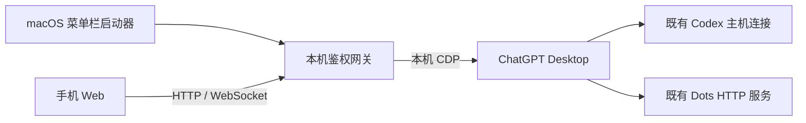

# Codex Launcher

[](LICENSE)

[](https://github.com/loock-ai/codex-launcher/releases/latest)

**在 Mac 上启动连接，在手机上继续桌面的 Codex 任务。**

Codex Launcher 基于 Tauri 2，是一个支持 macOS 与 Windows 的桌面插件宿主，统一管理插件和共享桌面连接。
内置 Mobile 插件提供手机可访问的 Web 页面，让你查看项目和会话、收发消息、处理审批，
也能在任务运行时补充引导，或者进入独立的 Dots 对话。

默认使用 **CDP 桌面桥接**：手机请求通过 ChatGPT Desktop 的既有服务执行，
使用桌面的会话和主机连接。启动器同时保留原 Codex Mobile 的托管和外部
app-server 模式。

[快速开始](#快速开始) · [日常操作](#日常操作) · [手机上可以做什么](#手机上可以做什么) ·
[连接设置](#连接设置) · [工作原理](#工作原理)

> 本项目独立开发，与 OpenAI 官方没有隶属关系。

## 快速开始

### 1. 构建启动器

需要 macOS、Node.js 20+，以及已安装并登录的 ChatGPT Desktop。
当前应用包以 Apple Silicon 为主，尚未签名，需从源码构建。

```bash
git clone https://github.com/loock-ai/codex-launcher.git
cd codex-launcher
npm install
npm run package:launcher
```

打开生成的应用：

```bash
open -n -a "src-tauri/target/release/bundle/macos/Codex Launcher.app" --args --open-web
```

只运行源码版面板，也可使用：

```bash
npm run launcher
```

### 2. 连接桌面

点击 Mac 菜单栏的 `⌘` 图标打开启动器。

1. 在 **桌面** 页核对 ChatGPT 应用路径与 CDP 端口并保存。
2. 在 **插件** 页打开 Mobile 的 **配置**，选择 **CDP 桌面桥接**；在插件连接页点击 **打开 Web** 进入网页。启用且开启自动启动的插件会随启动器运行。
3. 如果 ChatGPT 已运行但没有开启 CDP，在 **桌面** 页点击 **强制重启 ChatGPT**，重新启动桌面并连接。

**强制重启**直接终止所配置 ChatGPT 安装包的主进程，随后以 CDP 参数启动。
该操作不弹确认框，运行中的任务、草稿和审批也不会阻拦重启。

### 3. 在手机上打开

手机与 Mac 连接同一网络，在 Mobile 插件配置页点击 **展开二维码**后扫码，
或点击 **复制连接链接**，把完整链接发送到手机浏览器。

二维码默认收起，可再次点击收起。完整链接包含访问口令，请使用复制功能，
不要只输入界面中显示的地址。

手机打开后，选择项目和会话即可继续操作。启动器默认使用：

| 项目 | 默认值 |
| --- | --- |
| 手机 Web 网关 | `19877` |
| 本机桌面 CDP | `9333` |
| 手机访问范围 | 局域网 |
| ChatGPT 应用 | `/Applications/ChatGPT.app` |

## 日常操作

| 按钮或页面 | 用途 |
| --- | --- |
| 启动并打开 Web | 建立连接后打开网页 |
| 打开 Web | 已启动时直接打开连接页面 |
| 展开／收起二维码 | 按需显示手机扫码入口 |
| 复制连接链接 | 复制包含访问口令的完整链接 |
| 停止连接 | 关闭启动器自己的网关，保留 ChatGPT 桌面应用 |
| 强制重启 | 直接强制重启 ChatGPT、开启 CDP 并重新连接 |
| 打开 ChatGPT | 打开配置的桌面应用 |
| 插件 | 管理启用、自动启动、手动启停、配置页面和重新加载 |
| 桌面 | 修改共享 ChatGPT 应用路径与 CDP 端口，打开、连接或强制重启桌面 |
| Mobile 设置 | 修改连接模式、Web 端口、访问范围和口令；修改前需停止服务 |
| Mobile 审批 | 查看等待处理的请求，并进入 Web 回答 |
| 日志 | 宿主页显示桌面与插件诊断；Mobile 页面显示自己的服务日志 |

关闭启动器面板后，连接会继续运行。退出启动器会停止它管理的连接服务。

### 通过命令打开 Web

在源码目录完成构建后：

```bash
node bin/codex-mobile.mjs launcher --open-web
```

使用打包应用：

```bash
open -n -a "src-tauri/target/release/bundle/macos/Codex Launcher.app" --args --open-web
```

普通启动会运行已启用且开启自动启动的插件并显示面板；`--open-web` 调用 Mobile 插件，必要时先启动服务再打开浏览器。Mobile 被禁用时会明确报错。启动器已有实例时会转交命令，
不会重复创建网关。

## 手机上可以做什么

Web 按浏览器 UA 区分桌面与移动设备：桌面常驻左侧会话栏，右侧显示对话；
手机和平板使用抽屉式侧栏。桌面窗口缩小后仍保持两栏，Dots 也保留侧栏入口。

| 功能 | 说明 |
| --- | --- |
| 项目与会话 | 获取所选主机的项目、会话列表和历史记录，长会话分页加载 |
| 收发消息 | 向桌面会话发送消息，查看回复、推理摘要和工具执行情况 |
| 运行中引导 | 任务运行时补充要求，继续当前任务，也可携带附件 |
| 审批与问题 | 处理命令、文件修改、权限请求和用户问题 |
| 非阻塞提问 | 问题卡片可收起、稍后回答，任务继续执行 |
| 模型与权限 | 查看并选择桌面提供的模型、思考强度和权限配置 |
| 图片与文件 | 上传附件、查看消息内容及可用的远程文件 |
| 远程主机 | 连接测试后选择需要展示的主机，在设备管理中分别开启或隐藏 |
| 多设备 | 保存多个 Mac 的网关连接，切换或汇总查看会话 |
| Dots | 独立入口，支持消息历史、文字、图片和文件发送 |

Dots 输入框和消息列表复用普通对话样式，隐藏滚动条但保留滚动。
每条消息最多 4 个附件，单个不超过 20 MiB，也可以只发送附件。
上传失败保留草稿；消息投递结果未知时保留核对记录，不自动重发。

| 会话列表 | 对话详情 | 设备设置 |
| --- | --- | --- |
|  |  |  |

## 连接设置

Mobile 插件提供三种模式：

| 模式 | 适用场景 |
| --- | --- |
| CDP 桌面桥接（默认） | 通过 ChatGPT Desktop 的既有连接控制桌面会话 |
| 原 app-server · 启动本机服务 | 由启动器启动并管理独立 app-server |
| 原 app-server · 连接已有服务 | 接入已运行的本机 app-server |

原 app-server 模式使用所选 Desktop 安装包内的 CLI，自动根据安装包布局查找，
不依赖全局 `codex` 路径。独立 app-server 进程不保证与桌面的运行状态同步。

配置保存在启动器的本机用户数据目录，配置文件权限为 `0600`。
默认不会设置开机启动；CDP 只监听本机，手机通过带访问口令的网关连接。

详细说明见 [桌面启动器指南](docs/desktop-launcher.md)。原 npm CLI、环境变量和
Android／iOS 构建说明见 [原 app-server 与移动端构建指南](docs/app-server-guide.md)。

## 工作原理



启动器负责配置、进程和连接生命周期。网关通过 CDP 调用桌面已有的
Electron／AppHost 服务，把手机请求发送到所选本机或远程主机。
CDP 模式不另起一套 Codex 会话进程，也不建立第二套持久化会话数据库。

程序调用接口见 [桌面程序控制通道](docs/desktop-control-channel.md)，
Dots 的房间、附件和身份处理见 [Dots 适配](docs/dots-adapter.md)。

## 当前边界

- Dots 支持桌面版本 `26.1002.52244` 和 `26.1007.30912`；原生用户问题快照仍绑定 `26.1002.52244`，升级桌面后可能需要更新适配。
- 普通权限审批尚无完整的快照补读；非阻塞用户问题有单独快照适配。
- Dots 接收采用前台轮询，暂不支持语音、创建 Dot 和复杂交互审批。
- 桌面新任务的云端工作位置选择尚未接入。
- 自动化覆盖受控 Electron 和浏览器链路，真实账户兼容性仍需实际使用确认。
- 当前访问口令方案适用于可信局域网；跨不可信网络连接应增加 HTTPS 和正式身份认证。

## 统一插件

启动器「插件」页管理配置目录 `plugins/` 中的插件。一个插件包可以提供 `main` 后台、`ui` 配置页面、`desktop` 桌面注入入口；既有 v1 脚本插件继续兼容。页面来自插件自身文件，通过隔离 iframe 与宿主通信。

- **启用**允许加载插件，关闭时停止并卸载；**自动启动**决定下次打开启动器时是否运行。
- **启动／停止**管理本次运行，停止不会关闭 ChatGPT，也不改变自动启动设置。
- **重新加载**读取当前配置目录中的插件，不覆盖用户修改。
- **Mobile**拥有三种连接模式、Web 服务、二维码、访问设置和审批页面；**会话时间**独立为桌面列表增加最近更新时间。二者共享桌面连接，停止 Mobile 不会停止会话时间插件。

宿主 `config.json` 保存桌面路径与 CDP 端口，`plugins.json` 保存启用和启动策略，`plugin-data/<插件ID>/` 保存各插件配置。首次安装复制内置插件；移走 Mobile 包后，宿主仍可管理其他插件和桌面。

插件后台运行在独立子进程，面向可信本地代码，不提供恶意 Node 代码沙箱。后台和页面接口见 [插件 SDK](docs/launcher-plugin-sdk.md)，脚本格式详见 [桌面脚本插件指南](docs/desktop-script-plugins.md)，整体设计见 [统一插件架构](docs/superpowers/specs/2026-10-12-launcher-plugin-runtime-design.md)。

## API 与插件规划

桌面程序内部原生服务、可修改能力及插件封装方向见
[桌面内部 API 能力参考](docs/desktop-internal-api.md)。
现有启动器 HTTP／WebSocket 接口另见 [网关 API 参考](docs/plugin-api-reference.md)。已提供统一后台、页面和注入入口；插件市场及恶意第三方代码安全沙箱仍不在当前范围。

## 开发与验证

```bash
npm run typecheck
npm test
npm run build:launcher
```

启动器、桌面通道和 Dots 的受控浏览器测试：

```bash
RUN_CDP_FIXTURE=1 npx vitest run \
  tests/server/launcher-panel.integration.test.ts \
  tests/server/control-interactive.integration.test.ts \
  tests/server/dots-web.integration.test.ts
```

## 许可证

本项目使用 [Apache License 2.0](LICENSE)。

## 桌面构建与更新

桌面版构建目标包含 macOS 13.5+ 的 Apple Silicon、Intel，以及 Windows 10+ x64，使用用户电脑上的 Node.js 20 或以上版本，安装包不再携带 Node 运行时。执行 `npm run package:tauri` 构建 Tauri 应用及 DMG；旧 Electron 构建保留为 `npm run package:electron`。源码调试使用 `npm run launcher`。

启动器「更新」页可检查新版本、查看说明、下载验签和安装重启。开发包未配置公钥时明确显示更新未配置。独立工作流 `build-desktop.yml` 负责三个目标构建及桌面发布，桌面 tags 与更新索引独立于安卓。签名配置、发布顺序和验收边界见 [桌面发布文档](docs/desktop-release.md)。

源码构建需要 Node.js、Rust stable；macOS 需要 Xcode Command Line Tools，Windows 需要 Microsoft C++ Build Tools。Windows 安装包使用 NSIS，首次运行需 WebView2；具体构建和验收状态见桌面发布文档。Windows 桌面应用路径填写实际 `.exe` 路径，默认值仅作位置提示。
