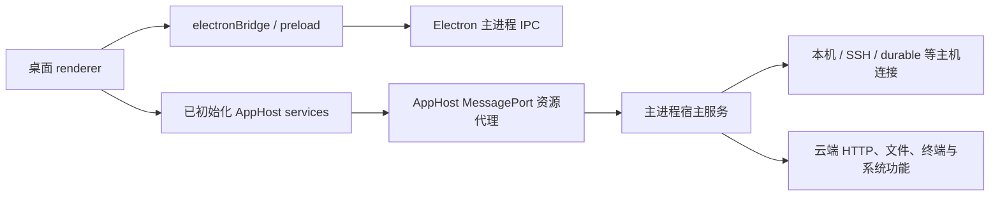

# ChatGPT / Codex Desktop 内部 API 能力参考

核对日期：2026-10-12。桌面版本：**26.1007.30912**。

本文整理的是 **桌面程序自身内部的原生服务与方法**，用于评估启动器未来可以封装哪些插件功能。它不是启动器 `/api/*` 网关的接口清单。已有网关接口另见 [网关 API 参考](plugin-api-reference.md)。

## 1. 先看结论

桌面内部已经具备项目管理、会话管理、消息收发、运行中引导、审批、文件操作、工作树、终端、通知、自动化、云端环境和原生插件配置等能力。

这些能力主要分为三层：

| 层 | 入口 | 能力 |
| --- | --- | --- |
| AppHost 服务 | 已初始化的 `services` 对象 | 项目、文件、通知、终端、工作树、环境等宿主功能 |
| 每个 host 的会话管理器 | `services.appServerManagers.open(hostId)` 返回的 `manager` | 会话、发送、引导、权限、审批、归档等业务功能 |
| Electron 消息与 app-server 请求 | `electronBridge`、管理器 `sendRequest` | 消息传输及原生协议调用 |

**当前网关只开放其中一部分。** 例如桌面内部存在项目创建、项目重命名、会话归档和文件写入方法，即使现有手机网关没有开放，也可以作为后续插件适配候选。

## 2. 证据与可用性定义

本轮只进行安装包静态分析，没有通过工具操作真实桌面会话。

- **已确认注册**：在桌面创建 AppHost 的代码中找到服务注册项。
- **已确认方法**：找到服务类、公开管理器 facade 或原生调用点中的方法。
- **已确认部分参数**：从方法解构、校验或调用代码确认字段；不代表恢复了完整 schema。
- **待运行验证**：该版本中的实际状态、权限、回调传输和完整返回类型尚未实测。

注册项可能受平台、功能开关、窗口类型或账户权限约束；“存在”不等于所有窗口都可立即调用。特别是 `appServerManagers` 受主进程管理器开关控制，代码有返回 unavailable 的分支。

已校验并分析的主要文件：

| 证据编号 | 安装包成员 | 内容 |
| --- | --- | --- |
| E1 | `.vite/build/main-CqEoQDOU.js` | AppHost 服务注册与主要实现 |
| E2 | `.vite/build/src-BJv5Mk7n.js` | 会话管理器公开 facade `vp`（导出 `Tr`）与内部实现 |
| E3 | `.vite/build/preload.js` | `window.electronBridge` 与 Electron IPC |
| E4 | `webview/assets/app-shared-8bd9d0399038.js` | 渲染器已初始化服务导出 `fN`、客户端会话接口 |
| E5 | `.vite/build/bootstrap-CooIJpZm.js`、`.vite/build/startup-requirements-C6B1x9gL.js` | 启动与宿主基础设施 |

文件 SHA-256、服务清单、管理器成员和源码字符偏移保存在 [静态接口索引](research/desktop-internal-api-26.1007.30912.json)。索引中的 `e/t/n` 是压缩后的参数名，不能当作业务字段名。

REA 整包分析因一个 unpacked 原生依赖校验不一致而失败；上述 JavaScript 分别核对了 ASAR 声明的完整性值。针对提取目录的 REA 应用图分析随后超时，未取得完整图结果。本清单来自这些具体文件的 AST 与定向文本提取，不声称完成了整个应用的无遗漏逆向。

## 3. 内部通道与生命周期



AppHost 通过 MessagePort 和资源代理传递对象、回调和可释放资源。它不只是“把 JSON 发给某个端口”。主进程按窗口身份注册 AppView；重新发起 `connect-app-host` 可能替换已有窗口绑定，应复用原先初始化好的服务。

当前版本的服务导出定位是：

```text
webview/assets/app-shared-8bd9d0399038.js → fN
```

`fN` 是这个构建的压缩导出名，不是稳定 API 名称。旧版 `26.1002.52244` 对应另一文件和 `aj` 导出，不能混用。

### 3.1 只读访问示意

以下代码仅说明在**已获准访问的桌面 renderer 上下文**中如何定位内部对象，不是在普通手机页面可直接执行的 SDK：

```js
const version = window.electronBridge?.getSentryInitOptions?.()?.appVersion;
if (version !== '26.1007.30912') throw new Error('需要核对该桌面版本的适配');

const module = await import(
  new URL('./assets/app-shared-8bd9d0399038.js', location.href).href
);
const services = module.fN;
const opened = await services.appServerManagers?.open('local');
if (opened?.status !== 'ready') throw new Error('主机管理器不可用');

// threadId 应来自当前主机的真实会话。
const state = await opened.manager.getConversation(threadId);
```

实际插件适配必须处理身份变化、host 失效和资源释放。部分代理返回值／订阅具有 `[Symbol.dispose]`，不能永久缓存，也不能将它们未经转换直接转给手机。只读示例不代表已经验证其完整运行时生命周期。

## 4. 项目与远程机器

### 4.1 `services.projects`

E1 注册为 `projects`，主要实现为 `qHe`。

| 原生方法 | 能力 | 性质 / 已确认参数 |
| --- | --- | --- |
| `getLocalProjects()` | 本机项目集合 | 读；注意返回集合形状以实际实现为准 |
| `getRemoteProjects()` | 远程项目集合 | 读 |
| `getProjectAppearances()` | 项目外观设置 | 读 |
| `getProjectRootPathsForHost(hostId)` | 所选主机的项目根目录 | 读 |
| `getWorkspaceRootOptions(hostConfig)` | 工作目录及标签选项 | 参数是 host 配置对象，不是单纯 ID |
| `getLocalProjectsForRenderer()` | 面向渲染器的项目数据 | 读 |
| `createLocal(request)` | 创建本机项目 | 写；已见 `name,sources,appearance,setActive,initializeDefaultWorkspaceGitRepository` |
| `editLocal(request)` | 修改本机项目及根目录 | 写；已见 `projectId,name,sources` |
| `renameLocal({projectId,name})` | 重命名本机项目 | 写；字段已确认 |
| `removeLocal(request)` | 移除本机项目记录 | 写；完整请求需继续核对 |
| `createRemote(request)` | 创建远程项目 | 写；已见 `hostId,remotePath,label,appearance,reuseExisting` |
| `editRemote({project})` | 修改远程项目 | 写；项目必须属于原主机 |
| `renameRemote({projectId,name})` | 重命名远程项目 | 写；字段已确认 |
| `removeRemote(request)` | 移除远程项目记录 | 写；完整请求需继续核对 |
| `setProjectOrder(projectIds)` | 调整项目顺序 | 写；字符串 ID 数组 |
| `setAppearance({projectId,appearance})` | 修改项目外观 | 写；appearance 结构待核对 |
| `setChatGptBacking(request)` | 关联 ChatGPT 项目后端 | 写；参数待核对 |

创建和编辑目录包含原生目录授权流程，可能返回 null 或 false。`removeLocal/removeRemote` 的名称不能解读为删除磁盘文件；插件 UI 必须区分“移除项目记录”和“删除文件”。

### 4.2 机器与目录相关服务

| 服务 | 已观察到的方法 / 入口 | 用途 |
| --- | --- | --- |
| `appServerManagers` | `open(hostId)`, `subscribe(hostId,callback)` | 获取并跟踪当前主机管理器 |
| `sshConnectionRegistration` | `add(request)`, `remove(request)` | 注册／移除 SSH 连接；请求字段待核对 |
| `remoteControlEnvironments` | `renameIfDefault(request)` | 远程环境名称处理；不是通用主机列表 API |
| `executionPaths` | `readCodexHome(request)` | 读取执行环境的 Codex Home |
| `threadProjectAssignments` | 已确认服务注册 | 会话与项目归属；完整方法待提取 |

远程主机目录还出现在桌面共享状态中，包括 `remote_ssh_connections` 和 `remote_control_connections_state`。应读取宿主维护的目录，不自行拼接 hostId 或把网关设备 ID 当主机 ID。

## 5. 会话管理器：最适合作为插件业务层

`services.appServerManagers.open(hostId)` 静态确认返回两类结果：

```ts
type OpenManagerResult =
  | {status: 'unavailable'}
  | {status: 'ready'; manager: /* 原生资源代理 */ unknown};
```

E1 返回 E2 的公开 facade。下面的方法已在该 facade 中确认，不是只在某个内部实现类里出现。许多成员通过 getter 返回可调用函数。

### 5.1 查询、列表与历史

| 原生方法 | 用途 |
| --- | --- |
| `getHostId()` | 所属主机 |
| `getWorkInProgress()` | 当前工作状态摘要 |
| `getConversation(threadId)` | 已加载的会话状态；可能没有缓存 |
| `readThread(...)`, `listThreadTurns(...)` | 读取原始会话及回合 |
| `getCachedThreadIds()`, `getCachedThreadMetadata(...)` | 已缓存的 ID 和元数据；不是全量列表 |
| `getCachedThreadSearchSnapshot()` | 缓存中的搜索快照 |
| `refreshRecentConversations(...)`, `loadRecentConversationIds(...)` | 刷新／加载近期会话 |
| `searchThreads(...)` | 会话搜索 |
| `hydratePinnedThreads(...)`, `hydrateBackgroundThreads(...)` | 加载置顶／后台会话 |
| `hydrateArchivedThreadPreview(...)` | 加载归档会话预览 |
| `ensureConversationFirstPage(threadId)` | 确保会话首屏可用 |
| `ensureConversationHistoryLoaded(...)` | 加载历史 |
| `loadOlderConversationHistoryPage(...)` | 加载更早历史页 |
| `loadOlderConversationTurnsPage(...)` | 加载更早回合页 |
| `loadRemainingTurnItems(...)` | 加载回合剩余消息项 |
| `getLatestTurnMessages(threadId)` | 最近回合的状态、输入与回复摘要 |
| `getConversationAncestry(threadId)` | 父会话、分叉与代理关系摘要 |
| `getCurrentPermissions(threadId)` | 当前权限 |
| `getThreadExecutionState(...)`, `getTurnModelContext(...)` | 执行状态和模型上下文 |

带 `...` 的条目表示方法名已确认、完整业务签名尚未还原；不能用表中的省略号直接构造调用。

### 5.2 消息与任务控制

| 原生方法 | 能力 | 备注 |
| --- | --- | --- |
| `prepareThreadStart(...)` | 准备新会话 | 可能涉及环境与目录准备 |
| `startConversation(params,callbacks)` | 创建会话 | 回调协议需适配 |
| `resumeConversation(...)`, `resumeThread(...)` | 恢复会话 | 有状态副作用 |
| `startTurn(...)` | 启动一轮任务 | 业务参数需核对 |
| `startTurnWithOutcome(...)` | 启动并区分投递结果 | 已见 `accepted/rejected/unconfirmed` 三种返回 |
| `steerTurn(...)` | 运行中补充引导 | 原生签名复杂，不等于简单文本函数 |
| `sendFollowUpMessage(...)` | 向会话发送后续消息 | 注意运行状态与排队语义 |
| `editLastUserTurn(...)` | 修改最后一次用户输入 | 写入行为 |
| `stopThread(...)`, `interruptConversation(...)` | 停止／中断会话 | 具体中断范围需核对 |
| `interruptSubagentDescendants(...)` | 中断子代理后代 | 影响范围大于当前一条消息 |
| `compactThread(...)` | 压缩上下文 | 修改会话运行状态 |
| `cleanBackgroundTerminals(...)` | 清理后台终端 | 有进程副作用 |

### 5.3 会话修改：桌面内部已经存在

| 原生方法 | 能力 |
| --- | --- |
| `setThreadTitle(threadId,title,options?)` | 重命名会话 |
| `archiveConversation(...)` / `unarchiveConversation(...)` | 归档／恢复归档 |
| `deleteArchivedConversation(...)` | 删除已归档会话 |
| `deleteAllArchivedConversations()` | 批量删除已归档会话 |
| `forkConversationFromLatest(...)` / `forkConversationFromTurn(...)` | 从最新状态或指定回合分叉 |
| `setPinnedThreadIds(...)` | 更新置顶 ID；不要假设可替代所有持久化置顶服务 |
| `markConversationAsRead(...)` / `markConversationAsUnread(...)` | 标记已读／未读 |
| `setThreadGoal(...)` / `setThreadGoalStatus(...)` / `clearThreadGoal(...)` | 管理任务目标 |
| `updateThreadGitBranch(...)` | 更新会话 Git 分支信息 |
| `updateThreadSettingsForNextTurn(...)` | 修改下一轮配置 |
| `runThreadModelSettingsUpdate(...)` | 执行模型设置更新 |
| `updateThreadPermissions(...)` | 更新会话权限 |
| `setDefaultModelConfig(...)` / `setDefaultServiceTierConfig(...)` | 修改默认模型／服务档位配置 |

这些都是桌面内部的候选插件能力。此前网关文档中“未开放重命名／归档”等描述只适用于网关，不能用于判断桌面原生能力。

此外，`services.threadArchive` 独立提供字段更明确的操作：

```ts
archiveInactiveThread({hostId, threadId, removeCatalogEntryIfMissing?, discardProvisionalThread?})
deleteArchivedThread({hostId, threadId})
deleteAllArchivedThreads({hostId})
```

删除和归档的语义不同；插件适配应分别建方法，不能混为“关闭会话”。

### 5.4 事件与订阅

公开 `manager.subscribe(descriptor)` 的分发代码识别这些 `type`：

```text
host / thread / subagentTitle / turn / item / event / notification / conversation
```

描述对象的其余字段与回调协议尚未完整还原，不能只传 `{type:"thread"}` 就宣称可用。

其他已确认的管理器入口包括：

- `addConversationHistoryInvalidationListener(...)`
- `observeCatalogThreads(...)`
- `registerWindowActivity(...)`
- `retainActiveConversation(...)`
- `getSubagentDescendantSnapshot(...)`
- `discoverSubagentDescendantSnapshot(...)`

内部实现还有更多 `add*Listener`，但没有全部直接出现在公开 facade；索引明确分开了公开 facade 与实现类，插件不应跨层调用私有实现。

### 5.5 审批和运行中询问

公开管理器已经暴露：

```text
replyWithCommandExecutionApprovalDecision(...)
replyWithFileChangeApprovalDecision(...)
replyWithPermissionsRequestApprovalResponse(...)
replyWithUserInputResponse(threadId, nativeRequestId, result)
replyWithOptionPickerResponse(...)
replyWithDynamicToolResponse(...)
replyWithMcpServerElicitationResponse(...)
beginUserVerification(...)
```

原生用户问题回答使用**原生请求 ID**。它与手机网关生成的 `control-approval:...` ID 不是同一层的标识。

会话状态中的 `requests` 是待处理请求来源之一；原生代码区分 `isBlocking`，非阻塞问题不要求任务停止。实际回答还可能经过 owner/follower 转发及动态工具兼容逻辑，不应绕过管理器直接修改缓存数组。

## 6. 文件、工作树和终端

### 6.1 `services.workspaceFiles`

E1 的 `$Me` 实现包含真实文件读写能力，支持按 host 路由。

```ts
read({hostId, path, representation: 'auto' | 'blob' | 'text', maxBytes?})
write({hostId, path, bytes, ifMatch?})
createDirectory({hostId, path})
```

这里 `bytes` 是二进制数据，不是任意 JSON 字符串。读取可返回 `etag`；写入已确认存在这些结果：

```text
{outcome:'saved', etag}
{outcome:'conflict', etag}
{outcome:'too-large', maxBytes}
```

写入会检查路径可访问范围和可选 `ifMatch`。因此未来“文件编辑插件”应保留 etag 冲突校验，不能简化成无条件覆盖。

同服务还存在 `getMetadata`、`getThumbnailDataUrl`、`createTemporaryFile`、`releaseTemporaryFile`、`saveCopy`、`downloadCopy`。

### 6.2 附件与文件搜索

| 入口 | 已确认方法 |
| --- | --- |
| `services.fileAttachments` | `captureScreenshotSelection`, `countFolderFiles`, `persistImageFileToTemp` |
| `services.libraryFiles` | `listOutputFiles`, `prepareFilePreview`, `releaseFilePreview`, `getThumbnailDataUrl` |
| `services.workspaceSearch` | `search` |
| `services.hostedThreadFiles` | `listSkills`, `searchFiles`, `cancelFileSearch`, `getRoot`, `readFile`, `getMetadata`, `readDirectory` |
| `manager` | `uploadLocalFileAttachments`, `createFileAttachment`, `copyLocalFileAttachment`, `createPastedTextAttachment`, `removePastedTextAttachment` |

“库文件”“本机临时附件”“云端会话文件”不是同一种 ID 或路径，插件 SDK 应分别建模。

### 6.3 `services.managedWorktrees`

已确认公开类成员：

```text
createForThread / removeFromThread / archiveForThread / restoreForThread
getPendingArchives / getCreationStatus / subscribeToCreation / getOwnerThreadId
registerThreadArchive / registerThreadUnarchive
```

适合工作树管理插件，但创建可能是异步操作；不能只根据请求返回就宣布工作树可用。具体输入、恢复快照规则和拥有者约束仍需逐项适配。

### 6.4 `services.localEnvironments`

```text
list(...)
read({configPath,hostId})
saveConfig({configPath,expectedRevision,hostId,raw})
```

这是本地环境配置能力，写入包含 revision 校验，与云端环境目录不是同一接口。

### 6.5 `services.terminal`

已确认：`create`、`attach`、`attachExisting`、`close`、`getAvailableShells`、`getShellCwd`、`getThreadSnapshot`、`transferSessionOwnership`、`resize`、`runAction`、`subscribe`、`unsubscribe`、`write`。

终端服务绑定创建它的窗口 `origin`，会话所有权和订阅不能仅靠一个 sessionId 复制。插件可以规划终端面板，但需要完整实现终端会话、输出订阅和资源释放，不能只透传 `write`。

## 7. 通知、窗口与系统交互

| 服务 | 已确认方法 | 说明 |
| --- | --- | --- |
| `notifications` | `show(request,onAction?)`, `hide(id)`, `previewSound`, `importSound` | 原生系统通知，支持回调与导航；完整通知 schema 待核对 |
| `clipboard` | `readText()`, `writeText(text)`, `bookmark()` | 系统剪贴板 |
| `applicationMenu` | `getSnapshot()`, `invokeItem(...)` | 应用菜单 |
| `windowNavigation` | `setHistorySwipeNavigationState`, `navigateInOwnerWindow` | 导航到拥有会话的窗口 |
| `appUpdates` | `checkForUpdates`, `checkForUpdateInformation`, `installUpdate`, `takeResumeState` | 桌面自身更新；不是启动器更新 |
| `appInfo` | `get()` | 桌面应用信息 |

同时注册了 `contentTabs`、`detachedWindows`、`browserTabs`、`browserHost`、`openIn`、`systemPermissions` 等服务。它们是浏览器面板、文件打开、独立窗口和权限设置插件的候选来源，但不能仅凭注册名推断完整方法或当前许可状态。

通知服务的回调使用可复制／可释放的原生资源句柄。未来“任务完成提醒插件”应由适配层托管回调，再向插件转发稳定事件。

### 7.1 自动化与任务通知

`services.automations` 注册到原生自动化服务，已确认实现包含 `list`、`create`、`update`、`delete`、`sync` 和 `getState`。创建、修改和删除属于写操作；该服务还包含账户迁移与状态同步逻辑，完整请求类型需另行核对。

同时注册了 `localAutomations` 和 `localAutomationsScheduler`，后者只在特定主窗口提供。它们与系统通知 `notifications` 是不同职责，不能用发通知的方法代替创建自动化。

## 8. 云端、Dots 与原生插件系统

### 8.1 `services.environmentConfigs`

E1 中服务实例 `xS` 继承 `dS`。已确认的基类方法包括：

```text
catalog / refreshCatalog / subscribeCatalog / list / request / delete
createDraft / saveEnvironmentValue / requestApproval / readOperation
requestVpn / requestPersonalSecrets / readPersonalEnvironmentVariable
listOutboundIdentityConnections / requestOutboundIdentityConnection
```

请求会检查账户与用户身份，部分操作包含 configId、revision 或 operationId。它支持的范围明显超出“列出云端环境”；但不同 method 的请求结构不同，不能把 `request` 当作任意 URL 代理。

桌面还注册了 `cloudTasks`（`read/subscribe`）、`localPersonalSecrets`（`listVariables/importVariables`）、`remoteControlEnvironments` 等服务。

`appServerManagers.open('durable')` 是云端主机管理器候选入口。新建云端任务涉及环境选择及创建回调，完整链路仍需专项适配；本轮没有创建任何云端任务。

### 8.2 Dots 使用内部 HTTP 服务

当前没有发现一个可以直接等同于网关 `DotsAdapter` 的稳定 `services.dots` 服务。已确认的路径是桌面客户端使用 `httpFetch` 访问账户下的 TBO／消息房间接口：

```text
/tbo
/tbo/primary
/messaging/rooms/{roomId}
/messaging/rooms/{roomId}/messages
/messaging/rooms/{roomId}/files
```

`httpFetch.fetch/cancel` 属于宿主传输能力，不应原样开放给插件。当前 Dots 适配代码已有具体调用，是后续收敛成稳定 `dots.*` 插件 API 的基础；接口参数详见 [Dots 适配](dots-adapter.md)。

### 8.3 桌面自己的插件／Skill／MCP 能力

这里需要区分 **桌面原生插件系统** 和 **我们计划做的启动器插件系统**。

静态代码中已经确认桌面调用这些原生协议方法：

```text
plugin/installed
plugin/list
plugin/read
plugin/install
plugin/uninstall
skills/list
config/batchWrite
config/mcpServer/reload
```

其中明确看到的启停配置调用形状为：

```js
// 桌面原生插件配置调用点的结构示意，不是启动器已开放接口。
manager.sendRequest('config/batchWrite', {
  edits: [{
    keyPath: `plugins.${pluginId}.enabled`,
    mergeStrategy: 'upsert',
    value: enabled
  }],
  reloadUserConfig: true
});
```

原始调用点使用 app-server 连接发送请求；管理器也暴露 `sendRequest(method,params,options?)`。是否可在目标 host 通过该管理器完成同一操作还需验证，尤其是参数校验、配置作用域和权限限制。

另外，`manager.listMcpServers`、`manager.callMcpTool`，以及 `services.pluginScheduledTasks.list`、`services.browserPluginConfig.syncAfterPluginChange` 均已确认存在。

**原生插件 enabled 配置不会自动控制我们的 Web 页面模块。** 若目标是在启动器勾选“会话管理、Dots、文件编辑、通知”等功能，仍需自己的插件注册表、生命周期和页面挂载机制。

## 9. Electron preload API

E3 明确向 renderer 暴露 `window.electronBridge`，主要方法如下：

| 方法 | 用途 |
| --- | --- |
| `sendMessageFromView(message)` | 发往主进程的窗口消息 |
| `sendWorkerMessageFromView(worker,message)` | 发往指定 worker |
| `subscribeToWorkerMessages(worker,callback)` | 接收 worker 消息，返回取消函数 |
| `acknowledgeChunkedMessage(...)` | 分块消息确认 |
| `getSharedObjectSnapshotValue(key)` | 读取已缓存共享对象 |
| `getInitialSidebarBootstrap()` | 获取侧边栏初始状态 |
| `getPathForFile(file)` | 从浏览器 File 对象取得桌面路径 |
| `startFileDrag(...)`, `startLinkDrag(...)` | 原生拖放 |
| `showContextMenu(...)` | 上下文菜单 |
| `getSystemThemeVariant()`, `subscribeToSystemThemeVariant(...)` | 系统主题 |
| `getSentryInitOptions()`, `getDesktopUserAgent()`, `getAppSessionId()`, `getBuildFlavor()` | 应用版本、会话和构建信息 |

这层是传输和窗口能力，不应等同于业务 API。主进程接收消息还会进行窗口、主机和请求处理。插件也不应通过通用 IPC 绕过宿主权限检查。

## 10. 启动器插件应如何封装这些内部 API

建议由启动器维护版本化 `DesktopAdapter`，把压缩导出名、AppHost 资源代理和回调转换隐藏在适配层：

```text
插件 → 稳定 Plugin SDK → DesktopAdapter → 原生 services / manager / IPC
```

| 建议插件 | 原生能力来源 | 首批适合开放的操作 |
| --- | --- | --- |
| 项目管理 | `projects`、SSH 注册、共享主机目录 | 列表、创建、重命名、编辑目录 |
| 会话管理 | 每个 host 的 `manager`、`threadArchive` | 列表、搜索、分叉、归档、标题修改 |
| 聊天与审批 | `manager` 的 turn、subscribe、reply 方法 | 收发、引导、中断、问题与审批 |
| 文件编辑 | `workspaceFiles`、`workspaceSearch`、附件服务 | 读取、带 etag 的保存、上传与搜索 |
| 工作树 | `managedWorktrees` | 创建状态、归档与恢复 |
| 通知 | `notifications` | 任务完成提醒和点击导航 |
| Dots | 受限 `httpFetch` 业务适配 | 房间消息与附件 |
| 原生插件管理 | plugin 协议、config 写入、MCP 状态 | 列表、启停、安装／卸载（分级授权） |

启动器里的每个开关应控制插件加载、页面挂载、订阅和配置；停用插件不自动中断其先前启动的任务。需要给插件的能力应按方法及主机范围授权，不能把整个 `services`、`manager.sendRequest`、`httpFetch` 或 `electronBridge` 原样交给第三方代码。

建议先实现只读项目／会话插件，然后逐项验证修改行为的参数、回执和失效情况。每个写方法都应明确：修改对象、主机／账户、是否幂等、结果未知如何核对、资源如何释放。

## 11. 本轮尚未还原的部分

- 大部分压缩参数的完整业务类型，特别是 `steerTurn`、终端创建、订阅描述和通知回调。
- 注册但未展开的浏览器、语音、Pages、可视化、运行时等服务的完整接口。
- 云端任务从环境选择到创建、审批、恢复的端到端调用。
- 桌面原生插件安装／启停在各类 host 上的实际行为。
- 新版本全部内部服务的真实账户调用与权限验证。

下一步应从具体插件场景挑选方法逐个补齐 schema 与受控测试，不把静态方法清单直接当成稳定 SDK。

## 12. 注册服务完整索引

以下名称来自 E1 的显式服务注册及可定位的展开工厂。包含条件注册、空值与非业务资源，不能把每一项都当作可调用函数；完整 JSON 见静态索引。

```text
globalState
appServerManagers
httpFetch
websitePreviews
pluginIncentives
appServerLifecycle
ambientSuggestions
automations
applicationMenu
customRuntime
appActions
clientCoordination
threadReadState
statsig
statsigEvaluations
diamond
settings
configSettingsWriteConfirmations
workModeAccess
appInfo
accessInputs
daybreakPreferences
cloudTasks
installerAttribution
artifactDocuments
latex
artifactSessions
orbPicker
avatarOverlay
avatarOverlayScroll
appUpdates
realtimeVoiceRuntime
browserProfileImport
browserHost
browserTabs
browserAutocomplete
browsingHistory
debug
demoTools
downloads
dynamicToolCalls
fileDrags
tabDragPreview
detachedWindows
contentTabs
hotkeyWindowCommands
hotkeyWindowHotkeys
inAppBrowserIncompleteNavigation
keyboardModifiers
shortcutCapture
libraryFiles
localEnvironments
managedWorktrees
deviceStorage
worktreeComposerEducation
projects
projectChatGptProvisioning
projectFolderConsent
sshConnectionRegistration
projectlessWorkspace
executionPaths
localThreadCatalog
localAutomationsScheduler
appshot
lsp
browserUsePermissions
browserPluginConfig
conversationalOnboarding
customAvatars
fileAttachments
github
workspaceFiles
workspaceSearch
dictationAudio
microphoneDiagnostics
dictationStreaming
systemAudioSpectrum
dictationHistory
owlFeatures
owlBrowserCrashCounter
primaryRuntime
localAutomations
pluginScheduledTasks
chromeNativeHost
chromiumBrowser
chatGptProjectFiles
chatGptBrowserSession
chronicle
pagesRealtime
pageCompanionTasks
performanceTelemetry
histogramCollector
pinnedThreads
processMemory
clipboard
computerUseSettings
textGeneration
realtimeContinuity
realtimeMemory
realtimeVoiceHistory
realtimeVoiceMultiAgentActivity
realtimeVoice
realtimeVoicePresentation
requestUserInputAutoResolution
userVerification
remoteControlEnvironments
remoteHostedPIP
startup
notificationPermissionsSupported
windowsShell
systemPermissions
systemFonts
terminal
threadArchive
threadMetadataGeneration
threadMetadata
threadProjectAssignments
threadTurnSummaries
triggers
tracing
hostedThreadFiles
environmentConfigs
localPersonalSecrets
cumberbatch
tppLocalExecutor
mcpAppSandbox
visualizations
codexMicro
notifications
openIn
windowNavigation
spotlight
pageWindows
browserAuthOperations
devboxVncService
localWebAuthn
pageCreationIntents
artifactPageHandoffs
pullRequestMessageGeneration
safetyRecourseGeneration
```

公开会话管理器 facade 的完整成员清单也保存在同一 JSON 中；其中 getter 返回的函数与普通方法均已记录。
