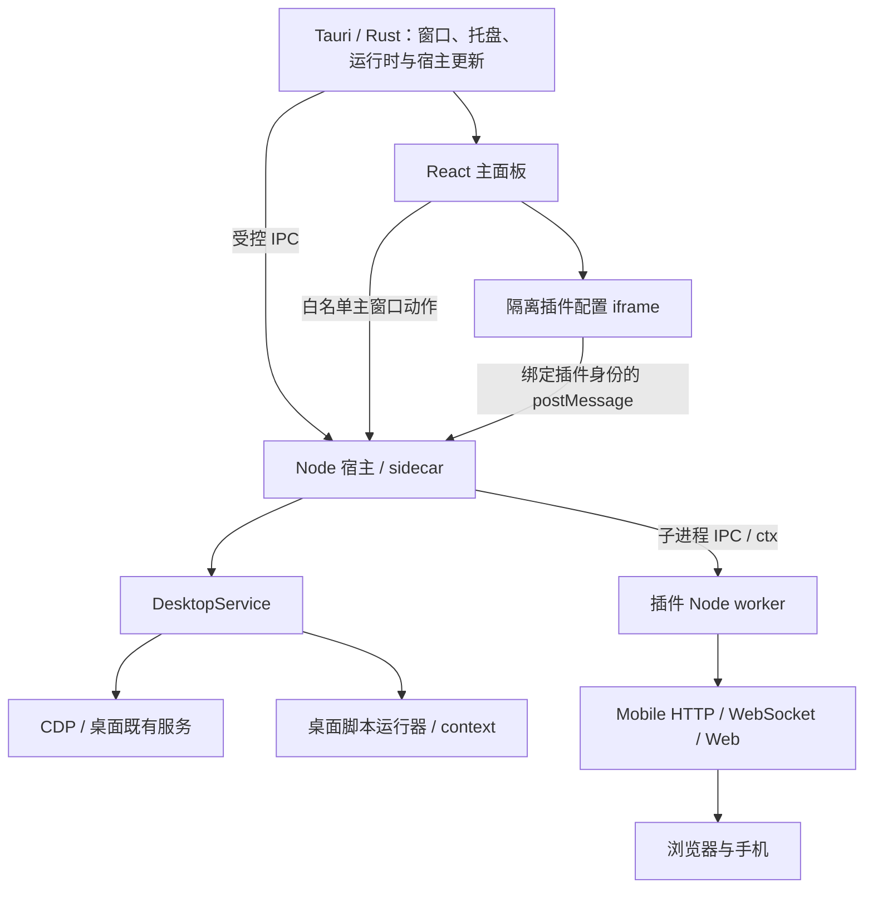

# Launcher 架构与源码归属

本文描述当前项目架构。对桌面安装包本身的 Electron/AppHost 研究，参见 [历史安装包快照](desktop-architecture.md)；它不是 Launcher 的实现结构。

## 两个仓库

| 仓库 | 唯一维护的源码 | 主要产物 |
| --- | --- | --- |
| [codex-launcher](https://github.com/loock-ai/codex-launcher) | Tauri 外壳、React 面板、Node 宿主、插件管理、共享桌面连接 | macOS DMG、Windows EXE |
| [codex-launcher-plugins](https://github.com/loock-ai/codex-launcher-plugins) | 会话时间、Mobile 配置页、Web 和业务后台 | 各插件的独立 ZIP、顶层版本目录、Android APK 与可选 iOS IPA |

安卓产品和 npm 包继续使用 Codex Mobile / `codex-mobile`。Android/iOS 封装、资源和发布在 Mobile 插件仓库，直接构建同一 UI；Launcher 仅保留固定发布包提供的旧 npm/Web 兼容输入。

## 进程与通信

- Rust 发现用户 Node.js 20+，启动 sidecar，管理窗口、托盘及宿主更新；不携带 Node 运行时。
- sidecar 只分发允许的主窗口方法；配置页面不能拿到 `window.launcher`。
- 每个 `main` 插件在独立 Node worker 运行，使用 `ctx` 请求配置、日志和共享能力。进程隔离用于生命周期回收，不是恶意代码沙箱。
- 共享桌面能力按插件分配租约。最后一个租约释放时关闭连接，不退出桌面应用。
- `desktop` 入口由宿主读取，在桌面 renderer 中执行。脚本使用 `context` 注册清理，直接操作 DOM 或适配过的内部服务。

## 插件边界

| 入口 | 环境 | 责任 |
| --- | --- | --- |
| `main` | Node worker | 注册动作、管理自己的服务和业务 |
| `ui` | 隔离 iframe | 配置界面，通过桥调用自己注册的动作 |
| `desktop` | 桌面 renderer | 页面修改、观察器、样式和对应清理 |

Mobile 通过 `ctx.host` 代理桌面控制、审批和 Dots 请求；HTTP/WebSocket 网关及浏览器 UI 属于 Mobile。宿主保留真正的 CDP 连接、认证服务适配与共享租约，不把连接所有权交给插件。

配置页打开只需加载插件，运行服务由 `start()` 负责。`stop()` 必须释放业务资源并可重复调用；完整卸载中止 signal，调用 `deactivate()` 和清理回调。单插件重载会等待旧宿主请求清理，防止旧请求释放新版资源。

## 依赖在哪里

| 依赖 | 位置与处理 |
| --- | --- |
| Node.js | 用户电脑，宿主发现可用的 20+ 运行时 |
| Launcher 运行依赖 | 应用资源 `backend/node_modules/` |
| Mobile 后台业务和库 | 插件 `main.cjs` 自包含打包，包含 `ws`、`qrcode` 等 JS 依赖 |
| Mobile 浏览器依赖 | 插件 `web/assets/`，React 等构建为浏览器资源 |
| 开发工具 | 各仓库 `node_modules/`，版本由各自 lockfile 固定 |

用户安装插件时不执行 npm install。后台开发者需提供完整 CJS 运行包；不能假设宿主的 node_modules 有自己的依赖。当前 Mobile 使用 JS 依赖的可移植包；其他插件若使用原生依赖，需要自行处理目标平台和 Node 兼容性。

## 固定内置包与兼容源码

Launcher 的 `plugins.lock.json` 固定内置插件版本、下载 URL 和 SHA-256。`scripts/fetch-builtin-plugins.mjs` 验证包、缓存并解压模板；网络失败不会猜测版本，损坏缓存不会绕过校验。

Mobile ZIP 的 `source/compatibility-files.json` 声明兼容源码清单。准备插件时生成 Launcher 工作目录中的 `src/`、部分 `server/`、`index.html` 等文件，它们是 git-ignored 构建输入。Launcher 旧 Web/npm 脚本与回归仍可使用既有导入路径；Android/iOS 工作流已迁往插件仓库，不再依赖此兼容源码准备。

这不是源码的第二个维护分支：修改插件请在插件仓库 `plugins/mobile/source/` 中进行，构建发布新插件包，再更新 Launcher 的锁定版本。直接修改生成文件会在下一次 `plugins:prepare` 中被覆盖。

`npm ci` 安装开发依赖后准备固定插件；`npm run build` 也会准备插件。执行了 `--ignore-scripts` 的开发环境需显式运行 `npm run plugins:prepare`。

## 安装、更新与删除

1. 来源配置存在 `plugin-repositories.json`，每个公开 GitHub 仓库提供顶层 `plugins.json`。
2. 检查更新只读目录，不下载插件 ZIP；失败来源单独报错，其他来源继续检查。
3. 安装使用所选来源、版本与 SHA-256，校验 ZIP 大小、路径、manifest 和宿主 API。
4. 更新备份旧代码，重载目标插件，保留数据与运行策略；失败恢复代码和策略，不重放业务写入。
5. 删除停止目标、清理在途宿主请求、备份代码，清除来源及启停策略；删除墓碑防止内置模板在重启时恢复。

宿主负责检查与安装，插件 backend/iframe 不能管理其他插件。已安装插件绑定来源；配置来源的 URL 变化不等于允许覆盖已安装插件的来源。

## 当前目录职责

| 路径 | 职责 |
| --- | --- |
| `src-tauri/` | Rust 外壳、Node 发现、配置目录迁移、主窗口白名单 |
| `launcher/` | React 面板、Tauri 桥；Electron 仅开发回退 |
| `server/launcher/` | 生命周期、私有配置、仓库、安装器、诊断与 DesktopService |
| `server/cdp/` 中的宿主实现 | 控制通道、桌面传输与内部模块适配 |
| `server/dots/desktop-*` | 桌面认证 HTTP 传输与内部接口适配 |
| `scripts/fetch-builtin-plugins.mjs` | 固定版本下载与兼容输入生成 |
| `plugins/` | 构建生成的内置模板，不在此维护插件源码 |
| `src/` 与部分 `server/` | Mobile 发布包生成的兼容输入 |

业务 HTTP、上传、Dots 业务适配及 Web 源码的权威位置是 [插件仓库 Mobile source](https://github.com/loock-ai/codex-launcher-plugins/tree/main/plugins/mobile/source)。运行接口见 [插件 SDK](launcher-plugin-sdk.md)，目录与发布规则见 [插件仓库规范](plugin-repositories.md)。
