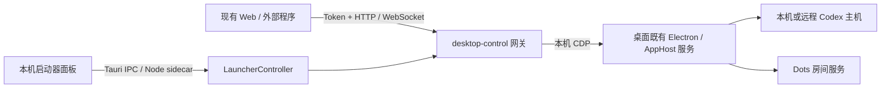

# 启动器网关 API 参考与插件化设计草案

本文范围是启动器已开放的网关与 IPC。桌面程序内部更完整的能力请先看 [桌面内部 API 能力参考](desktop-internal-api.md)。

更新日期：2026-10-12。范围：当前源码中的 `desktop-control`（CDP 桌面连接）与 Dots 适配。核对基于当前工作树，包含尚未提交的改动；不代表 npm 已发布版本或所有已安装应用包的能力。

本文先列出**现在可以调用的 API**，再说明如何把它们封装为可由启动器开启、关闭的插件。当前已实现配置目录脚本的发现、加载、启停和重新加载，见 [桌面脚本插件](desktop-script-plugins.md)。统一后台、UI 和注入运行器现已实现，见 [启动器插件 SDK](launcher-plugin-sdk.md)。细粒度权限授予尚未实现；后文历史“设计建议”仍以新 SDK 文档为准。

## 1. 当前能力总览

| 类别 | 已有读取能力 | 已有修改或控制能力 |
| --- | --- | --- |
| 主机与项目 | 主机列表、项目列表、项目详情 | 暂无创建、修改、删除项目接口 |
| Codex 会话 | 会话列表、搜索、详情、历史分页 | 新建会话、恢复会话 |
| Codex 对话 | 接收消息、工具与任务事件 | 发送消息、运行中引导、停止当前 turn |
| 模型与权限 | 查询可用模型、权限配置 | 在新建会话或发送 turn 时指定模型、权限等参数 |
| 审批与用户问题 | 接收请求；补读部分原生用户问题 | 回答当前客户端已经收到的请求 |
| Codex 文件 | 读取目标主机文件 | 上传附件；不开放任意路径写文件 |
| Dots | Dot 列表、房间消息、能力与诊断 | 上传附件、发送文字或附件消息 |
| 启动器 | 状态、配置、连接日志 | 保存配置、启动／停止连接、强制重启桌面、打开 Web；仅本机受信任面板可用 |

“当前网页有入口”“桌面原生存在此功能”和“网关开放了 API”是不同的判断依据。插件可依赖的能力应以本文公开接口和运行时检查为准。

## 2. 三种调用边界



- **网关 HTTP / WebSocket**：现有 Web 和程序可调用；是未来插件业务 API 的主要来源。
- **启动器 IPC**：Tauri 主窗口经白名单 IPC 调用 Node 后台，插件页面通过父框架绑定身份转发；Electron 回退入口校验 `webContents` 和 `senderFrame`。不能把 `window.launcher` 当作任意网页或插件现成可用的 API。
- **桌面内部接口**：由适配层使用，不作为稳定插件契约。插件不应直接操作 CDP、动态导入桌面模块或获取账户凭据。

原 `managed` / `external` app-server 模式有另一套透传行为，不能将其能力自动算到 CDP 模式上；参见 [原 app-server 指南](app-server-guide.md)。

## 3. 地址、鉴权与主机选择

启动器默认网关地址为 `http://<Mac 地址>:19877`，独立 `control` CLI 默认端口为 `19878`。用户配置可能修改端口，应使用实际连接地址。

```text
HTTP: http://<Mac 地址>:<端口>/api/status?token=<网关口令>
WS:   ws://<Mac 地址>:<端口>/ws?token=<网关口令>
```

当前鉴权使用 URL 查询参数 `token`，不是 Bearer Header，也没有插件专用 Token。API 请求和 WebSocket 升级均需口令；静态 Web 资源无需口令。HTTP 支持带鉴权的跨来源请求与 OPTIONS。

### 3.1 hostId 的含义

- `GET /api/desktop/hosts` 返回桌面知道的可路由主机，`local` 表示桌面所在电脑。
- HTTP 用 `hostId` 查询参数选择主机，省略时为 `local`。
- WebSocket 在 `initialize` 中绑定一个 `hostId`；同一连接不能重新初始化或切换主机。需要多主机时建立多条连接。
- **不要把 `/api/host` 返回的设备标识当作路由 hostId**。设备标识用于识别网关连接；路由值应来自 `/api/desktop/hosts`。
- 网页中的“是否展示主机”目前是客户端显示配置，不是服务端访问控制。
- Dots 使用桌面绑定的账户及 Dot ID，不使用 Codex 远程主机的 `hostId` 路由。

## 4. HTTP API：Codex 桌面连接

以下接口除另有说明外使用 GET，查询参数均须包含 `token`。

| 接口 | 参数 | 返回摘要 | 是否修改 |
| --- | --- | --- | --- |
| `/api/status` | 可选 `hostId` | 连接状态、会话序号、能力标记 | 否 |
| `/api/host` | 可选 `hostId` | 网关标识、电脑名称、`backend: "desktop-control"`、就绪状态 | 否 |
| `/api/desktop/hosts` | 通常无需 `hostId` | `{data:[{hostId,displayName}]}` | 否 |
| `/api/projects` | 可选 `hostId` | `{projects:["绝对目录", ...]}`；服务器遍历项目分页并汇总根目录 | 否 |
| `POST /api/uploads/file` | 可选 `hostId`；原始文件请求体 | `{path,name,type,size}`，成功 HTTP 201 | 写入附件 |

`/api/status` 的 `connected` 和 `/api/host` 的 `appServerReady` 当前反映共享桌面通道状态，不是每个远程 host 的独立健康保证。

`/api/projects` 是给现有前端使用的目录摘要，不保留完整项目对象。需要项目 ID 和原始结构时调用 WebSocket `project/list`。

### 4.1 能力返回

`/api/status`、`initialize` 和 `desktop/status` 包含类似结构：

```json
{
  "connected": true,
  "channelSessionId": "channel-session-id",
  "sequence": 42,
  "capabilities": {
    "structured": true,
    "approvalSnapshot": false,
    "userInputSnapshot": true,
    "steering": true,
    "chunkedMessages": true,
    "dots": true
  }
}
```

能力标记不是所有功能实时健康的保证：`dots` 表示已配置适配器，还需检查 `/api/dots/status`；`userInputSnapshot` 表示传输层提供快照方法，仍可能受到桌面版本和主机状态限制。

### 4.2 Codex 附件上传

```http
POST /api/uploads/file?token=<口令>&hostId=local
Content-Type: image/png
X-Codex-File-Name: screenshot.png

<原始文件字节>
```

文件名使用 `encodeURIComponent(file.name)` 编码。单文件不超过 20 MiB，空文件拒绝。文件写入**所选主机**的 `/tmp/codex-mobile-uploads/<随机名>`，响应中的 `path` 是目标主机路径。

- 图片：在 `turn/start` 或 `turn/steer` 的 input 中使用 `{type:"localImage",path:"上传返回的路径"}`。
- 其他文件：现有前端将文件名称和目标主机路径作为文本引用交给任务读取。
- 当前没有附件删除 API，也不自动清理临时文件。
- 任意路径 `fs/writeFile` / `fs/createDirectory` 不开放给 WebSocket 客户端；仅上传服务内部使用。

## 5. WebSocket API

### 5.1 请求、响应与初始化

协议使用请求 ID 关联响应，不要求 `jsonrpc: "2.0"` 字段。

```json
{"id":"init-1","method":"initialize","params":{"hostId":"local"}}
```

先等待初始化响应，再发送业务请求。初始化只建立网关客户端状态，不向桌面原有 app-server 重复 initialize。

```json
{"id":"req-1","method":"thread/list","params":{"limit":20,"cursor":null}}
```

```json
{"id":"req-1","result":{"data":[],"nextCursor":null}}
```

```json
{"id":"req-1","error":{"code":-32000,"message":"不支持此方法","data":{"code":"UNSUPPORTED_METHOD"}}}
```

`id` 必须为字符串或数字。普通业务错误的分类在 `error.data.code`，不能只看外层 `-32000`。

### 5.2 网关控制方法

| method | params | result / 行为 |
| --- | --- | --- |
| `initialize` | `{hostId?: string}` | 绑定主机并返回连接能力；每连接一次 |
| `desktop/status` | `{}` | 当前通道状态 |
| `desktop/subscribe` | `{threadIds: string[] \| null}` | `{subscribed:true}`，替换当前订阅 |
| `desktop/unsubscribe` | `{}` | `{}`，停止业务订阅并撤销该客户端已收到的审批回答资格 |
| `desktop/approval/respond` | `{approvalId, result}` | `{submitted:true,confirmed:false}`，提交当前已投递请求的回答 |

订阅语义：

- `threadIds: ["thread-id"]`：接收指定会话，以及符合主机匹配的无会话目录通知。
- `threadIds: null`：接收当前主机全部会话事件；**不启用所有会话的问题快照扫描**。
- `threadIds: []`：仅接收无会话 ID 的目录通知。
- 新建、恢复和发送不会自动订阅，程序应主动订阅，避免漏掉紧接着到达的事件。

### 5.3 已开放的业务方法

这些方法通过白名单转发到所选桌面主机。业务参数与原始结果遵循目标 Desktop 的 app-server 契约，不由网关统一转换。下面列的是用途和常用字段，不是所有版本完整的 JSON Schema。

| method | 常用参数 / 用途 | 返回摘要 | 读写性质 |
| --- | --- | --- | --- |
| `model/list` | `limit,cursor,includeHidden` | `data,nextCursor`，可用模型与能力 | 读 |
| `permissionProfile/list` | `cwd,limit,cursor` | `data,nextCursor`，权限配置 | 读 |
| `project/list` | `limit,cursor` | 原始项目对象、`nextCursor` | 读 |
| `project/read` | 目标版本定义的项目定位参数 | 项目详情 | 读，网关已放行 |
| `thread/list` | `limit,cursor,archived,sortKey` 等 | `data,nextCursor` | 读 |
| `thread/read` | `threadId`；历史选项按桌面契约 | 会话详情 | 读 |
| `thread/search` | 搜索参数按桌面契约 | 搜索结果 | 读，网关已放行 |
| `thread/turns/list` | `threadId,limit,cursor` 等 | 回合分页；附带 `__desktopSnapshotSequence` | 读 |
| `thread/items/list` | 会话／回合定位和分页参数按桌面契约 | 消息项分页；附带快照序号 | 读 |
| `fs/readFile` | `{path:"目标主机绝对路径"}` | `{dataBase64: string}` | 读文件 |
| `thread/start` | `cwd`，可选模型和权限参数 | `{thread,...}` | **写：创建会话** |
| `thread/resume` | `threadId`，可选恢复参数 | 恢复后的会话数据 | **有副作用：恢复运行上下文** |
| `turn/start` | `threadId,input`，可选模型等参数 | `{turn,...}` | **写：发送并启动任务** |
| `turn/steer` | `threadId,expectedTurnId,input,clientUserMessageId` | 原生引导响应 | **写：修改运行中任务的输入** |
| `turn/interrupt` | `{threadId,turnId}` | 原生停止响应；完成状态由事件确认 | **控制：停止 turn** |

“网关已放行”不等于已在所有桌面版本完成真实账户验收。`project/read`、`thread/search` 等完整参数需要以目标版本的 schema 核对，不应凭方法名猜测。

### 5.4 新建、发送与运行中引导

新建会话：

```json
{"id":"new-1","method":"thread/start","params":{"cwd":"/path/to/project"}}
```

从返回值 `thread.id` 获取真实 ID，然后订阅并发送：

```json
{"id":"sub-1","method":"desktop/subscribe","params":{"threadIds":["thread-id"]}}
```

```json
{
  "id":"send-1",
  "method":"turn/start",
  "params":{
    "threadId":"thread-id",
    "input":[{"type":"text","text":"请检查这个项目的测试状态","text_elements":[]}]
  }
}
```

向正在运行的同一 turn 补充要求：

```json
{
  "id":"steer-1",
  "method":"turn/steer",
  "params":{
    "threadId":"thread-id",
    "expectedTurnId":"当前运行的真实 turn ID",
    "clientUserMessageId":"客户端生成的唯一消息 ID",
    "input":[{"type":"text","text":"请优先检查登录模块","text_elements":[]}]
  }
}
```

`expectedTurnId` 用来约束目标任务，不能把上一轮或本地临时 ID 当作当前运行 ID。

### 5.5 修改模型与权限

当前没有独立的 `model/set` 或 `permissions/set` 公共方法。修改通过 `thread/start` / `turn/start` 参数表达，现有前端使用：

- `model`：从 `model/list` 选择。
- `effort`：用于 `turn/start`，从模型支持的思考强度中选择。
- `permissions`、`approvalPolicy`、`approvalsReviewer`：按目标桌面的权限契约提交。
- `serviceTier`：是否允许和如何使用依赖模式及模型能力，不应作为全版本保证。

省略参数表示不显式覆盖；不等于写入一个名为“沿用桌面权限”的配置。不要假设权限列表条目可以原样塞进 `permissions`，应按原生 schema 构建。

## 6. 事件、审批和非阻塞问题

### 6.1 事件结构

```json
{
  "method":"item/agentMessage/delta",
  "params":{"threadId":"thread-id","turnId":"turn-id","itemId":"item-id","delta":"新的文字"},
  "hostId":"local",
  "channelSessionId":"session-id",
  "sequence":43
}
```

常见事件包括 `turn/started`、`turn/completed`、`item/started`、`item/completed`、`item/agentMessage/delta`，以及原生工具、文件和推理相关通知。网关保留方法名和参数，不对所有事件另定义一份稳定插件模型。

`sequence` 是源通道序号，过滤会话后可能跳号，不代表一定丢消息。当前没有事件回放 API；重连后需要重新初始化、订阅并回读历史。`__desktopSnapshotSequence` 可用于协调分页历史与随后到达的实时事件。

### 6.2 可回答的服务器请求

| method | 类型 |
| --- | --- |
| `item/commandExecution/requestApproval` | 命令执行审批 |
| `item/fileChange/requestApproval` | 文件修改审批 |
| `item/permissions/requestApproval` | 附加权限请求 |
| `item/tool/requestUserInput` | 用户问题 |
| `item/tool/requestOptionPicker` | 选项选择 |
| `mcpServer/elicitation/request` | MCP 信息请求 |

这些请求包含网关生成的 `id: "control-approval:..."`。回答时使用该 ID，不能使用原生内部请求 ID。只有当前连接已经收到、尚未失效的请求才可提交。

用户问题示例：

```json
{
  "id":"control-approval:example",
  "method":"item/tool/requestUserInput",
  "params":{
    "threadId":"thread-id",
    "turnId":"turn-id",
    "itemId":"item-id",
    "isBlocking":false,
    "questions":[{"id":"format","header":"格式","question":"希望哪种格式？","options":[{"label":"简短","description":"只给结论"}]}]
  },
  "hostId":"local",
  "channelSessionId":"session-id",
  "sequence":44
}
```

回答示例：

```json
{
  "id":"answer-1",
  "method":"desktop/approval/respond",
  "params":{
    "approvalId":"control-approval:example",
    "result":{"answers":{"format":{"answers":["简短"]}}}
  }
}
```

其他审批的 `result` 必须随请求类型构建，不能给所有请求统一发送 `{decision:"accept"}`。接口放行某种请求，也不代表现有 Web 为每种请求都提供了完整表单。

- 只有明确 `isBlocking:false` 的问题采用非阻塞交互；回答本身不会额外暂停或恢复任务。
- `submitted:true,confirmed:false` 只表示提交动作返回，不代表上游已最终处理。
- 等待 `desktop/approval/resolved` 或权威快照撤销请求；`desktop/approval/submitted` 是兼容直接响应形式的通知。
- 问题变化时旧 ID 失效，不能继续提交旧答案。
- 每 1.5 秒补读显式订阅会话的用户问题，最多 8 个不同 host/thread 组合；此限制属于整个网关，不是每个插件。
- 普通权限审批尚无完整快照补读。传输中断会收到 `desktop/disconnected`，此后应重新建立通道。

## 7. HTTP API：Dots

所有接口位于 `/api/dots/`，使用同一网关 Token。Dots 与 Codex 的附件和会话 ID 不可混用。

| 接口 | 参数 / 请求体 | 返回摘要 |
| --- | --- | --- |
| `GET /status` | 无额外参数 | `available,identityKey,error?,capabilities`；可包含 `code` |
| `GET /list` | 可选 `cursor` | `{dots:[{id,name,roomId,threadId?,paused?}],nextCursor}` |
| `GET /messages` | `dotId`，可选 `before` | `{roomId,dotName?,messages,before}` |
| `GET /diagnostics` | 无额外参数 | 最近发现及消息映射的结构计数，不触发上游查询 |
| `POST /upload` | 查询 `dotId`，文件名／MIME 请求头和原始字节 | `{attachment:{id,name,type,size}}` |
| `POST /send` | `{dotId,text,requestId,attachmentIds?}` | `{message}` |

`/status` 返回 `mode:"polling"`，当前可用能力包括 messages/history/attachments；`approvals` 为 false。`identityKey` 是匿名身份指纹，不是鉴权口令。

### 7.1 上传与发送

```http
POST /api/dots/upload?token=<口令>&dotId=<编码后的Dot ID>
Content-Type: application/pdf
X-Codex-File-Name: report.pdf

<原始文件字节>
```

```json
{
  "dotId":"dot-id",
  "text":"请总结这个文件",
  "requestId":"客户端生成且不复用的唯一 ID",
  "attachmentIds":["upload 返回的 attachment.id"]
}
```

上传返回的附件 ID 是本网关生成的编号，绑定 Dot 与实际房间，不是客户端可任意提供的原生 `file_id`。只发送附件时 `text` 可以为空字符串。

限制与投递语义：

- 单文件最多 20 MiB，每条消息最多 4 个附件；JSON 正文最多 64 KiB，文字最多 60000 UTF-8 字节。
- 上传文件名为 URI 编码，MIME 为普通 `类型/子类型`；不接受多余查询参数和未知发送字段。
- `requestId` 在同一网关生命周期内用于去重；重复 ID 必须匹配同一 Dot、文字和附件列表。
- 发送账本和上传登记表默认各有 1000 条容量限制，不持久化；重启后不能继续使用旧的上传编号。
- 房间改变返回 `DOTS_ROOM_CHANGED`，需要重新上传。上传成功不等于消息已发送。
- 附件回执与预期文件不一致时返回 `DOTS_WRITE_UNKNOWN`，不能直接重发消息。
- 桌面账户变化后通道要求重启／重新连接，不自动跨账户继续发送。

### 7.2 消息结构

```ts
interface DotMessage {
  id: string;
  role: 'user' | 'assistant' | 'system';
  text: string;
  createdAt: string;
  requestId?: string;
  deleted?: boolean;
  attachments?: Array<{id: string; name: string; type: string; size: number}>;
}
```

当前 Dots 没有向插件开放的实时事件订阅 API。现有页面在前台每 3 秒读取最新消息，后台暂停。`before` 用于向前翻页；消息合并以 ID 去重，不能只按文字比较。历史附件元数据不等于可下载 URL，当前没有独立的 Dots 文件下载／删除接口。

## 8. 启动器本机 IPC

以下方法来自 `window.launcher`，**仅限当前启动器面板**。未来插件若需要调用，应经过插件宿主封装和授权。

| 方法 | 参数 | 行为 / 返回 |
| --- | --- | --- |
| `listPlugins()` | 无 | 插件目录、元数据、启用状态和注入状态 |
| `setPluginEnabled(id,enabled)` | 插件 ID、布尔值 | 保存开关并按连接状态注入或撤销 |
| `reloadPlugins()` | 无 | 卸载、重读配置目录脚本并应用 |
| `openPluginsFolder()` | 无 | 打开本机插件目录 |
| `getStatus()` | 无 | `LauncherStatus` |
| `subscribe(callback)` | 状态回调 | 监听状态变化，返回取消函数 |
| `saveConfig(config)` | 完整 `LauncherConfig` | 保存配置并返回状态；运行时拒绝保存 |
| `start()` | 无 | 启动当前模式服务并返回状态 |
| `stop()` | 无 | 停止自身服务并返回状态 |
| `restart()` | 无 | 直接强制重启配置的 ChatGPT，开启 CDP 并连接；无确认弹窗 |
| `openDesktop()` | 无 | 打开配置的桌面应用 |
| `openMobile()` | 无 | 用默认浏览器打开当前连接 URL；要求服务已启动 |
| `copyUrl()` | 无 | 复制含口令的完整连接 URL |
| `desktopStatus()` | 无 | CDP 运行时返回通道与待处理审批；其他情况返回 null |
| `approve(id,choice)` | ID 与选择 | **仅保留旧方法名，当前总是提示到 Web 对应会话处理，不可作为有效审批 API** |

`LauncherStatus`：`config,running,phase,error,clients,approvals,thread,accessUrl,logs`。其中 `thread` 字段不应被当作完整的活动会话列表；状态里的 `config.token` 和 `accessUrl` 含口令，不应直接暴露给插件。

`LauncherConfig`：

```ts
interface LauncherConfig {
  mode: 'cdp' | 'managed' | 'external';
  gatewayPort: number;
  cdpPort: number;
  appServerPort: number;
  host: '127.0.0.1' | '0.0.0.0';
  token: string;
  appPath: string;
  cliPath: string;
  upstreamUrl: string;
}
```

三个端口不得冲突；口令为 16–256 字符；应用与 CLI 路径必须为绝对路径。保存时 `cliPath` 由所选 Desktop 路径规范化；external 上游仅允许本机 WebSocket 地址。当前没有远程 HTTP“修改启动器配置”或“重启桌面”接口。

## 9. 错误和重试规则

| 分类 | 含义 | 插件建议行为 |
| --- | --- | --- |
| `NOT_INITIALIZED` / `ALREADY_INITIALIZED` | 初始化顺序错误 | 修正连接状态机 |
| `UNSUPPORTED_METHOD` | 未开放方法 | 隐藏能力或提示不支持，不尝试内部通道绕过 |
| `HOST_UNAVAILABLE` | 主机缺失或不可用 | 刷新主机列表，等待用户重新选择 |
| `INVALID_PARAMS` | 参数不合法 | 修正参数 |
| `CHANNEL_LOST` / `REQUEST_TIMEOUT` | 断线或读取超时 | 只读请求可在重连后有限重试 |
| `UPSTREAM_ERROR` | 原生接口返回错误 | 展示错误；不要一律重试写操作 |
| `ACTION_WRITE_UNKNOWN` | 修改可能已发生，回执未知 | 保留请求上下文并核对，禁止自动重发 |
| `APPROVAL_EXPIRED` | 请求已撤销、已提交或不属于当前客户端 | 移除旧操作入口，重新读取当前状态 |
| `RESPONSE_TOO_LARGE` | 读取响应超限 | 减少分页大小 |
| `DOTS_ACCOUNT_CHANGED` | 账户身份发生变化 | 清理旧账户视图，重新连接 |
| `DOTS_UPLOAD_UNKNOWN` | 文件上传结果未知，尚未发送消息 | 保留草稿，单独提示附件核对 |
| `DOTS_WRITE_UNKNOWN` | Dots 消息可能已投递 | 保留 requestId，核对历史，禁止自动重发 |
| `DOTS_ROOM_CHANGED` | 上传后 Dot 房间变化 | 重新上传后再明确发送 |
| `DOTS_LEDGER_FULL` / `DOTS_UPLOAD_FULL` | 网关记录容量已满 | 核对已有请求，不自动循环重试 |

WebSocket 入站消息上限 256 KiB；桌面分块响应组装上限 64 MiB。Dots 宿主 JSON 响应上限 16 MiB。上传二进制走 HTTP，不应把大文件 base64 塞进 WebSocket。

已知实现差异：`server/cdp/control-client.ts` 的 Node 辅助客户端当前尚未把 `turn/steer` 纳入自身超时写操作分类，而服务器和 Web 客户端已纳入。未来 SDK 封装需补齐；在此之前，对引导请求的任何超时／断线都应按“结果未知”处理。本文记录该差异，本轮不修改实现。

## 10. 现在可以用这些 API 做哪些插件

下面是可建立在现有业务能力之上的插件类型。本地脚本加载器已有实现，但这些业务插件及统一 SDK 仍需分别实现。

| 插件类型 | 可复用的现有 API | 仍需插件层提供 |
| --- | --- | --- |
| 项目／会话浏览器 | hosts、project/list、thread/list/read、历史分页 | 插件页面、主机范围和权限 |
| 会话助手 | thread/start/resume、turn/start/steer/interrupt、事件订阅 | 草稿与任务状态、写入去重和结果核对 |
| 审批中心 | 订阅、服务器请求、desktop/approval/respond | 按请求类型渲染表单、用户操作授权 |
| 文件助手 | fs/readFile、HTTP 上传、消息输入 | 文件范围限制、预览和附件生命周期 |
| Dots 聊天 | dots/status/list/messages/upload/send | 独立账户状态、前后台轮询、投递核对 |
| 只读运行看板 | status、thread/list、任务通知 | 多主机聚合及重连后的历史恢复 |

目前**不能直接承诺**的能力：项目增删改、会话重命名／归档／置顶／删除、任意文件写入或删除、全量审批快照、云端新建任务选择、Dots 创建／删除／暂停、Dots 复杂审批、远程插件安装和通用插件配置 API。即使桌面原生或旧 app-server 支持，也要单独加入适配与公开契约。

## 11. 完整插件 SDK 设计建议（未实现）

### 11.1 使用方式

启动器已有“插件”页管理本地注入脚本。下一阶段可将 Codex、Dots 和只读看板封装为业务插件，再接入下述稳定 SDK 与权限机制。

每个插件展示名称、说明、所需能力、适用模式、开启状态、运行状态、配置和最近错误。用户可以独立启停；插件失败不应影响其他插件或关闭整个桌面连接。

“用户已开启”和“当前可运行”分开记录。例如 Dots 已开启但桌面版本不兼容时，显示不可用原因，保留用户选择。

### 11.2 插件声明示例

**设计草案，尚无加载器解析此 JSON：**

```json
{
  "id":"builtin.dots",
  "name":"Dots 对话",
  "version":"1.0.0",
  "apiVersion":"1",
  "entry":"./plugin.js",
  "supportedModes":["cdp"],
  "capabilities":["dots.read","dots.upload","dots.send"],
  "ui":{"title":"Dots","route":"dots"}
}
```

### 11.3 建议的权限映射

下列 capability 名称均为建议，不是当前服务端已经实现的权限。

| 建议 capability | 允许的操作 |
| --- | --- |
| `desktop.read` | 脱敏状态与主机列表 |
| `projects.read` | project/list/read |
| `threads.read` | thread/list/read/search、turns/items 分页 |
| `events.subscribe` | 授权主机和会话范围内的事件 |
| `threads.create` / `threads.resume` | thread/start / thread/resume |
| `turns.send` / `turns.steer` / `turns.interrupt` | 对应 turn 操作 |
| `approvals.respond` | 回答已投递给该插件、且已获用户授权的请求 |
| `files.read` / `files.upload` | 限定目录读取／附件上传 |
| `dots.read` / `dots.upload` / `dots.send` | 限定 Dot 范围的操作 |
| `launcher.configure` / `launcher.restart` | 主程序受控操作，默认不授予普通插件 |

现有网关 Token 可以访问整个已开放接口集，无法按插件隔离。因此不能只增加一个 manifest 和 UI 开关就声称实现权限控制。

### 11.4 插件宿主与 SDK

建议增加一个 **PluginHost**，由启动器持有连接、凭据和权限检查，向插件提供范围受限的接口：

```ts
// 仅用于讨论的接口形状，当前不存在这些导出。
interface PluginContext {
  api: ScopedDesktopApi; // 主机、会话、Dot、目录范围由宿主验证
  storage: PluginScopedStorage;
  signal: AbortSignal;
  ui: PluginUiRegistry;
  logger: RedactedLogger;
}

interface Plugin {
  activate(context: PluginContext): Promise<void>;
  deactivate(): Promise<void>;
}
```

建议 SDK 提供 `hosts.list`、`projects.list`、`threads.list/read/create/resume`、`turns.send/steer/interrupt`、`events.subscribe`、`approvals.respond`、`files.read/upload`、`dots.list/messages/upload/send` 等命名方法。具体方法签名需在 SDK 实现阶段定义，不向插件暴露任意 method 透传、原始网关 Token 或启动器完整配置。

不能让多个插件直接共享一条 WebSocket 并各自调用 `desktop/subscribe`：当前订阅是**替换**语义。第一版可以为每个插件、每个 host 建独立连接；后续由宿主统一合并订阅并重新分发。即使采用独立连接，用户问题补读仍受全网关 8 个目标的上限约束。

### 11.5 启停和隔离要求

1. 启用：校验声明、模式、版本、权限和配置，再启动插件，保存用户选择。
2. 停用：取消轮询、订阅和未派发操作，释放 UI 与连接资源；不自动停止 Codex 任务。
3. 已派发修改不能靠 AbortSignal 撤回。停用时仍须保存未知投递记录，避免重新启用后重复发送。
4. 插件存储按插件 ID 隔离，凭据由宿主持有，日志脱敏。
5. 第一阶段仅加载可信内置插件。真正的第三方代码需要进程或受限页面隔离和 IPC 权限校验，不能在同一 Electron Node 上下文加载后仅靠约定隔离。
6. 启动器的“插件开关”是插件生命周期控制，不应直接等同于放行整个桌面连接的权限。

### 11.6 建议实现顺序

1. 整理当前 API 契约，补齐 Node 客户端写入结果分类，建立统一能力与错误定义。
2. 用内置插件实现注册表、启停、配置、错误展示；先接只读看板与 Dots。
3. 添加 SDK、宿主范围检查、订阅分发与投递账本，再迁移 Codex 对话和审批。
4. 内置插件生命周期和权限验收完成后，再设计第三方安装、升级、签名及隔离。

此节是稳定 SDK 与权限机制的设计草案；目前本地脚本实现仅覆盖配置目录加载、启停与清理。

## 12. 源码依据

| 来源 | 对应内容 |
| --- | --- |
| [control-http.ts](../server/cdp/control-http.ts) | Codex HTTP 路由与鉴权 |
| [control-gateway.ts](../server/cdp/control-gateway.ts) | WebSocket 初始化、订阅、审批和公共方法限制 |
| [control-channel.ts](../server/cdp/control-channel.ts) | 业务白名单、写操作、事件和问题快照 |
| [control-client.ts](../server/cdp/control-client.ts) | Node 辅助客户端及超时分类差异 |
| [control-upload.ts](../server/cdp/control-upload.ts) | Codex 附件上传限制与路径 |
| [Dots HTTP](../server/dots/http.ts)、[适配器](../server/dots/adapter.ts) | Dots 路由、上传和发送语义 |
| [Dots transport](../server/dots/desktop-transport.ts) | 当前声明的兼容桌面版本；能力以运行时结果为准 |
| [preload.cjs](../launcher/preload.cjs)、[main.cjs](../launcher/main.cjs) | 启动器面板 API 与 IPC 来源检查 |
| [controller.ts](../server/launcher/controller.ts)、[config.ts](../server/launcher/config.ts) | 启动器操作、状态与配置校验 |
| [turn-steering.ts](../src/app-server/turn-steering.ts)、[model-catalog.ts](../src/app-server/model-catalog.ts) | 引导参数与模型／权限查询 |
