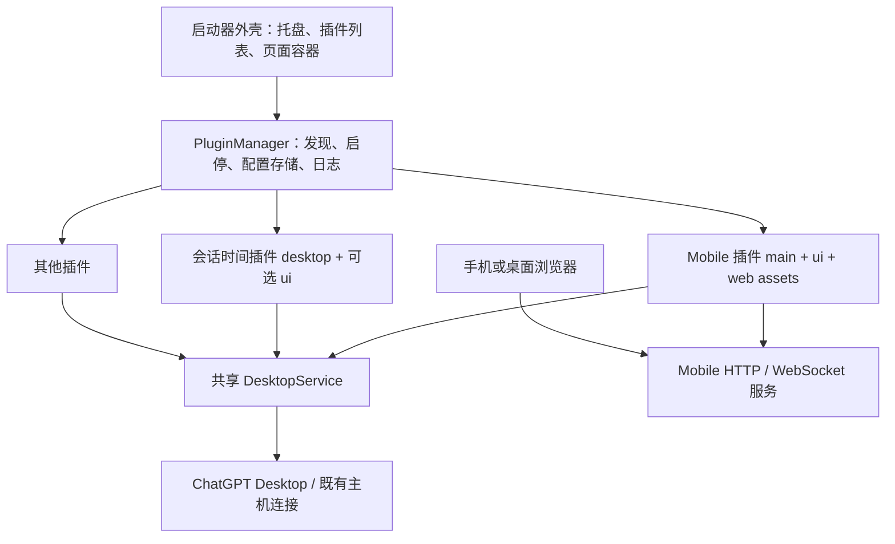

# Codex 启动器统一插件架构设计

日期：2026-10-12。状态：设计草案，待评审；本轮不重构运行代码。

现有代码检查点：`7d4fb37`（此前还包括 `002ee2b` 桌面布局、`808cafb` Dots 兼容改动）。代码检查点已在本地提交，未推送。

## 1. 目标

用户提出两项统一要求：

1. 插件可以提供启动器自身的配置页面和操作入口。
2. Mobile 应成为一个插件；Mobile 的配置、Web 服务启动／停止、打开网页、二维码等功能由插件实现。

因此，启动器应成为通用插件宿主，支持执行插件后台代码、加载插件界面和管理桌面注入。插件代码继续位于用户配置目录，可独立更新。

成功标准：禁用 Mobile 后，会话时间插件仍能运行；移走 Mobile 插件包后，启动器仍能正常打开和管理其他插件。

## 2. 推荐方案

采用 **一个插件包、三个可选入口**：

| 入口 | 执行位置 | 负责什么 |
| --- | --- | --- |
| `main` | 插件后台进程 | 配置校验、业务服务、启动／停止、命令处理 |
| `ui` | 启动器内的隔离页面 | 配置表单、按钮、二维码、插件状态展示 |
| `desktop` | 目标桌面 renderer，由宿主注入 | 桌面界面增强，保留现有 signal/onDispose 清理机制 |

一个插件可以只有 desktop，也可以同时包含 main 和 ui，或三者都有。不要拆成两套互不兼容的“启动器插件”和“注入插件”。

### 备选方案比较

| 方案 | 优点 | 主要问题 |
| --- | --- | --- |
| 继续在 LauncherPanel 中增加插件配置字段 | 改动少 | 每加一个功能都要改宿主，不符合插件自行实现页面的目标 |
| 在 Electron 主进程直接 import 全部插件 | 接入简单 | 插件故障可能拖垮托盘和其他插件，热重载资源难清理 |
| **统一入口＋独立后台＋插件页面（推荐）** | 功能归插件，生命周期可管理，兼容纯注入插件 | 需要一次通用通信和生命周期改造 |

第一阶段服务于可信的本地／内置插件，不做插件市场，也不承诺对恶意第三方 Node 代码提供安全沙箱。

## 3. 宿主与插件的职责



### 3.1 宿主保留什么

- 应用名称、托盘、主窗口、插件列表、通用导航和页面容器。
- 插件发现、版本校验、开启状态、启动策略、加载、停止、重新加载。
- 配置存储、日志、受控系统操作、后台进程和资源回收。
- **共享 DesktopService**：应用路径、CDP 端口、连接状态、版本适配、主机访问和注入生命周期。
- 明确的核心操作：打开桌面、连接桌面、由用户发起的强制重启。

### 3.2 Mobile 插件负责什么

- 连接模式选择：CDP、托管 app-server、外部 app-server。
- Web 监听地址、端口、访问口令、外部上游地址等 Mobile 配置。
- HTTP / WebSocket 服务、静态 Web 资源、附件接口及当前 Dots 网页功能。
- Mobile 服务启动、停止、健康检查、连接数统计与错误展示。
- 打开 Web、复制连接链接、二维码生成与展开／收起。
- 自己的连接页、设置页、审批入口和日志页。

宿主不再识别 Mobile 的具体字段，也不直接调用 `createControlGateway`、生成二维码或拼接手机访问 URL。

### 3.3 会话时间插件负责什么

- 读取原生会话时间、增加标签和样式、观察列表变动、释放资源。
- 可选的设置页面，例如相对时间／完整时间、字号、颜色。
- 依赖 DesktopService，不依赖 Mobile 服务，也不需要先打开 Mobile 的 Web 端口。

## 4. Mobile 插件需要提供的功能

| 功能 | UI 归属 | 后台实现归属 |
| --- | --- | --- |
| 监听地址、Web 端口、访问范围 | Mobile 设置页 | Mobile 配置校验与 HTTP 监听 |
| 访问口令 | Mobile 设置页，默认脱敏 | Mobile 鉴权；敏感值存储使用宿主提供的独立接口 |
| CDP / managed / external 模式 | Mobile 设置页 | Mobile 选择接入方式 |
| ChatGPT 路径、CDP 端口、共享连接状态 | 宿主桌面设置；Mobile 可提供跳转入口 | DesktopService |
| 托管 app-server 参数、外部上游 URL | Mobile 设置页 | Mobile 启动或连接对应服务 |
| 启动／停止 Web 服务 | Mobile 连接页 | Mobile 的 start/stop 生命周期 |
| 打开 Web、复制链接 | Mobile 连接页或插件声明的快捷操作 | Mobile 生成地址，再调用宿主打开／复制能力 |
| 二维码 | Mobile 连接页 | Mobile 生成，不进入宿主核心 |
| 客户端连接数、服务错误、端口占用 | Mobile 状态页面 | Mobile 上报实际服务状态 |
| 审批摘要、跳转 Web 处理审批 | Mobile 页面 | Mobile 订阅共享通道，转发已有审批流程 |
| 启动器打开后自动启动 Mobile | 宿主通用启动策略 | 宿主调用 Mobile.start，真正业务动作仍由 Mobile 实现 |

第一阶段将现有 Mobile 整体迁入插件，不同时把 Web 内的每个功能拆成独立插件。Dots 页面先随 Mobile 保留，后续有明确需求再提供 Web 扩展点。

## 5. 插件目录与声明

建议目录：

```text
<启动器配置目录>/
├── config.json                    # 宿主：桌面路径、CDP 端口等共享设置
├── plugins.json                   # 注册状态：enabled、autoStart、已接受的插件版本
├── plugins/
│   ├── mobile/
│   │   ├── manifest.json
│   │   ├── main.mjs               # 后台业务入口
│   │   ├── ui/                    # 启动器内的配置页面
│   │   │   ├── index.html
│   │   │   └── assets/
│   │   └── web/                   # 提供给手机／浏览器的现有前端产物
│   └── desktop-thread-time/
│       ├── manifest.json
│       ├── desktop/inject.js
│       └── ui/                    # 可选配置页面
└── plugin-data/
    ├── mobile/                    # 配置、状态、日志；不与代码一起覆盖
    └── desktop-thread-time/
```

Mobile 的 `ui/` 是启动器中的管理页面；`web/` 是手机访问的网页。二者不是同一个入口。

声明草案（v2，当前加载器尚不支持）：

```json
{
  "manifestVersion": 2,
  "id": "mobile",
  "name": "Mobile",
  "version": "1.0.0",
  "launcherApiVersion": "1",
  "defaultEnabled": true,
  "autoStartDefault": true,
  "entrypoints": {
    "main": "main.mjs",
    "ui": "ui/index.html"
  },
  "permissions": [
    "desktop.control",
    "desktop.discoverCli",
    "service.listen",
    "process.spawn",
    "system.openExternal",
    "clipboard.write"
  ],
  "pages": [{"id":"mobile","title":"Mobile"}],
  "actions": [{"id":"open-web","title":"打开 Web"}]
}
```

会话时间插件可以只声明 `entrypoints.desktop`。其现有 v1 `entry: "inject.js"` 由兼容适配器解释为 desktop 入口，不要求用户立即改脚本。

权限字段是新宿主需要落实的契约，不是目前已经提供的安全隔离。对于拥有完整 Node 权限的可信后台插件，进程隔离主要用于故障和资源管理。

## 6. 后台、界面和宿主如何通信

### 6.1 后台入口与生命周期

建议每个 main 插件使用独立 Electron utility process。它不能直接控制宿主窗口或调用任意 Electron IPC，必须通过宿主提供的通信接口。

下面是契约草案，不是已实现的 SDK：

```ts
export async function activate(ctx: PluginContext): Promise<PluginRuntime> {
  const mobile = new MobileService(ctx);
  ctx.actions.register('config.read', readConfigSchema, () => mobile.readConfig());
  ctx.actions.register('config.save', saveConfigSchema, input => mobile.saveConfig(input));
  ctx.actions.register('open-web', emptySchema, () => mobile.openWeb());
  ctx.actions.register('copy-url', emptySchema, () => mobile.copyUrl());
  ctx.onDispose(() => mobile.stop());

  return {
    start: () => mobile.start(),
    stop: () => mobile.stop(),
    getStatus: () => mobile.getStatus(),
    deactivate: () => mobile.dispose()
  };
}
```

`activate` 加载插件和注册操作，不自动启动业务服务。宿主的 autoStart 策略再调用 start。这样服务停止时仍可进入插件设置页修改配置。

纯 desktop 插件由宿主提供兼容运行器：start 注入，stop 撤销，保持现有 `context.signal` 和 `context.onDispose`。

### 6.2 插件 UI

插件自行提供编译后的 HTML / JS / CSS，可使用 React，也可以不用框架。宿主只提供容器，不再为每个插件硬编码表单。

推荐使用隔离 iframe 加载插件 UI：

- 资源通过按插件隔离的本地协议加载，只允许访问该插件的 UI 资源。
- UI 不开启 Node，不直接获得 `window.launcher`、CDP 连接或完整配置。
- 宿主建立绑定当前 frame、插件 ID 和加载代次的 MessageChannel。
- UI 请求经过操作名与参数 schema 校验，再分发给自己的插件后台。
- 页面卸载只结束 UI 订阅，不自动停止插件后台和 Web 服务。

UI SDK 草案：

```ts
await plugin.call('config.read', {});
await plugin.call('config.save', {gatewayPort: 19877, host: '0.0.0.0'});
await plugin.runtime.start();
await plugin.call('open-web', {});
const unsubscribe = plugin.runtime.subscribeStatus(renderStatus);
```

这些请求无需也不得由 UI 自带 `pluginId` 来选择其他插件。身份由宿主绑定的消息端口决定。

第一阶段可继续使用现有 React 表单和二维码组件，把它们迁到 Mobile 插件 UI；需要自动表单的简单插件以后再增加 schema 表单，不强迫所有页面使用同一种表单生成器。

### 6.3 后台 SDK 的最小能力

| 能力 | 用途 |
| --- | --- |
| `ctx.config.read/write` | 插件自己的非敏感配置与校验、版本迁移 |
| `ctx.secrets.get/set` | 插件自己的敏感配置，普通 UI 状态返回脱敏值 |
| `ctx.actions.register` | 定义允许 UI 调用的操作与参数 schema |
| `ctx.status.publish` | 上报 stopped/starting/running/waiting/error 等业务状态 |
| `ctx.desktop.acquireControl` | 取得共享桌面控制租约和范围受限的请求接口 |
| `ctx.desktop.acquireInjection` | 通过宿主应用该插件声明的桌面脚本 |
| `ctx.process.spawn` | 注册插件拥有的托管进程，停用时可回收 |
| `ctx.system.openExternal` | 按已授予权限打开 Web 地址 |
| `ctx.clipboard.writeText` | 复制链接等用户触发操作 |
| `ctx.logger`、`ctx.signal`、`ctx.onDispose` | 日志、取消与资源生命周期 |

不要给后台插件统一塞入当前 `LauncherController` 对象，否则新的宿主只是把原来的耦合换了一个名字。

## 7. DesktopService 必须独立于 Mobile

这是本次拆分的关键。

目前 `LauncherController.startInternal()` 先启动 Mobile 网关，再通过 `plugins.bind(cdpUrl)` 让注入插件工作。这个顺序让时间插件实际上依赖 Mobile。新架构必须解除这一依赖。

建议 DesktopService 统一拥有：

- Desktop 应用路径、CDP 地址及连接就绪状态。
- 已初始化桌面控制通道及版本化适配器。
- 注入运行器、页面重载通知、连接丢失与恢复。
- 按插件分配的租约、订阅和资源清理记录。

Mobile 和时间插件分别 acquire / release：

- 关闭 Mobile：停止网关、客户端连接和它自己启动的 app-server；释放自己的桌面租约。
- 时间插件仍开启：保留其桌面连接和标签。
- 所有租约释放：断开宿主自己的连接，不退出用户的 ChatGPT。
- 强制重启桌面：是宿主全局操作，必须通知所有依赖插件进入 waiting，再统一恢复。

插件只取得代理，不直接共享一个可随意修改订阅的底层 WebSocket。宿主按插件合并和分发订阅，避免一个插件调用 subscribe 替换另一个插件的订阅。

审批响应也在宿主统一协调：某请求提交后，其他插件应收到失效／处理中的状态，避免 Mobile 与独立审批插件重复回答同一请求。

## 8. 启用、启动与自动启动要分开

| 概念 | 含义 |
| --- | --- |
| enabled | 用户允许加载这个插件；关闭时停止并卸载 |
| autoStart | 下次启动器启动时，是否自动运行该插件的服务或注入功能 |
| loaded | 后台已加载，操作和配置页面可用 |
| runtime state | stopped、starting、waiting、running、stopping、error |

启动流程：

```text
读取插件注册表 → 校验插件 → 加载 enabled 插件
→ 展示插件页面入口 → 对 autoStart 插件调用 start
→ 插件自行启动服务／申请桌面连接／报告状态
```

推荐默认值：Mobile 和会话时间均 enabled=true、autoStart=true；用户已保存的关闭选择优先。

用户点击 Mobile 的“停止”只停止本次运行，不必卸载插件；本次进程内不自动把它拉起。下次重启启动器时仍按 autoStart 处理。用户要长期停用可关闭 autoStart 或 disabled。

失败和等待必须区分：没有 CDP 时等待桌面连接，不表示插件代码损坏；端口被占用时 Mobile 报告端口错误，不终止其他服务；后台崩溃时该插件独立报错，宿主保持可操作。

## 9. 配置和资源归属

### 9.1 配置归属

| 现有字段 | 新归属 |
| --- | --- |
| `appPath`, `cdpPort` | 宿主 DesktopService 配置 |
| `mode`, `gatewayPort`, `host`, `appServerPort`, `upstreamUrl` | Mobile 插件配置 |
| `token` | Mobile 的敏感配置存储 |
| `cliPath` | 由 DesktopService 根据安装包发现；Mobile 使用发现结果 |
| 脚本 enabled 集合 | 新插件注册表，保留已有显式选择 |

插件配置保存由插件校验业务规则，宿主负责按插件隔离和原子写入。第一阶段 Mobile 运行时保存监听端口等关键字段仍要求先停止服务，不在这次架构迁移中额外引入热切换端口。

### 9.2 包与更新

插件代码以已构建产物分发。Mobile 的后台、配置页和手机 Web 资源都必须跟随其插件包；不要再从宿主根目录隐式读取 `dist/` 或源码目录。

不在运行时自动执行 `npm install`。后台依赖应在插件构建时打包，或作为经过准备的插件依赖目录交付。

保持现有原则：首次安装复制模板，不覆盖用户修改。更新使用显式替换／版本安装流程，保留旧包，停止旧运行器后再切换。普通“重新加载”只重新读取配置目录中现有代码，不从安装包覆盖它。

移动插件重载会断开它管理的 WebSocket；状态页应清楚展示停止和启动阶段。桌面注入插件重载则只清理并重新注入自己的内容。

## 10. 从当前代码迁移

建议分阶段完成，每阶段保持可使用。

1. **提取共享桌面连接。** 从 controller 中分离 DesktopService，让现有脚本插件独立于 Web 网关。先验证关闭 Mobile 后时间标签仍存在。
2. **增加 v2 插件运行器。** 支持 main 后台入口、通用生命周期、状态与动作通信，保留 v1 注入脚本兼容。
3. **增加插件页面容器。** 支持插件自己提供 UI，移除宿主对插件字段和按钮的硬编码。
4. **迁移 Mobile。** 将网关创建、三种模式、静态 Web、设置、二维码和连接按钮整体移入 Mobile 插件。
5. **迁移配置并去除旧入口耦合。** 写入前备份旧配置；保留用户端口、口令、访问范围以及插件选择。macmini 等机器可能使用 18766，不能统一重置成 19877。
6. **处理命令兼容。** `--open-web` 在兼容入口映射为 Mobile 插件的 `open-web` 动作；新通用入口可以是 `--plugin mobile --action open-web`。Mobile 的 open-web 动作保留“必要时先启动服务，再打开浏览器”的行为，由插件自己实现。Mobile 被禁用时明确报错或打开插件管理页，不偷偷启用它。

当前文件对应关系：

| 当前位置 | 目标 |
| --- | --- |
| `launcher/main.cjs` 的应用壳、IPC 来源检查 | 宿主保留，改成通用插件操作路由 |
| `launcher/Panel.tsx` 的 Mobile 连接／设置／审批内容 | Mobile 插件 UI |
| `LauncherController.startInternal/stopInternal` 的网关、managed/external 分支 | Mobile 插件后台 |
| controller 的桌面启动、连接、重启与版本适配 | DesktopService |
| `ScriptPluginHost` 的脚本生命周期 | PluginManager 下的 DesktopInjectionRunner |
| `src/` 和 `dist/` 的 Mobile 网页 | 第一阶段继续共用源码；构建产物进入 Mobile 插件包 |
| 各插件的 UI 及业务配置 | 配置目录插件代码与 plugin-data |

## 11. 验收标准

- 移除 Mobile 包后，启动器仍正常启动，插件列表和桌面管理可用。
- 关闭 Mobile 不关闭时间插件；关闭时间插件不影响 Web 服务。
- Mobile 配置页面和启动按钮来自插件文件，宿主没有 Mobile 字段分支。
- 新增一个 main+ui 插件只需放入插件目录并重新加载，不重新打包宿主。
- Mobile 三种模式仍可运行，现有端口、Token 和前端行为保留。
- 界面卸载、切换插件页面不会停止后台服务。
- 插件停止、崩溃、快速启停、重载和桌面重连都有明确状态且没有残留进程或订阅。
- 插件 UI 不能伪造其他插件身份，也拿不到宿主完整配置。
- 停止或超时不能触发重复写入；已发出的消息仍按未知结果规则核对。
- 原生脚本异常和清理超时不会阻塞整个启动器退出。

## 12. 本轮决策建议

建议确认三点后再进入实施计划：

1. Mobile 作为完整的 main+ui 插件迁移，先不拆其内部 Web 功能。
2. DesktopService 是宿主共享基础设施，不归 Mobile 插件所有。
3. 配置页面由插件提供自定义 UI；宿主只提供容器、身份绑定和生命周期。

用户已批准实施。当前工作树已实现第一阶段统一运行器；实际接口与未实现边界以 [插件 SDK](../../launcher-plugin-sdk.md) 为准，本文保留为设计依据。
